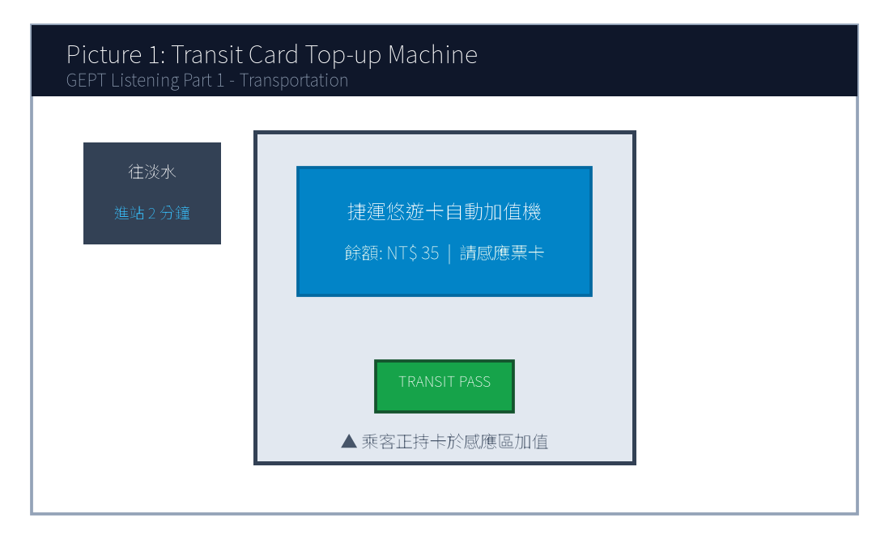
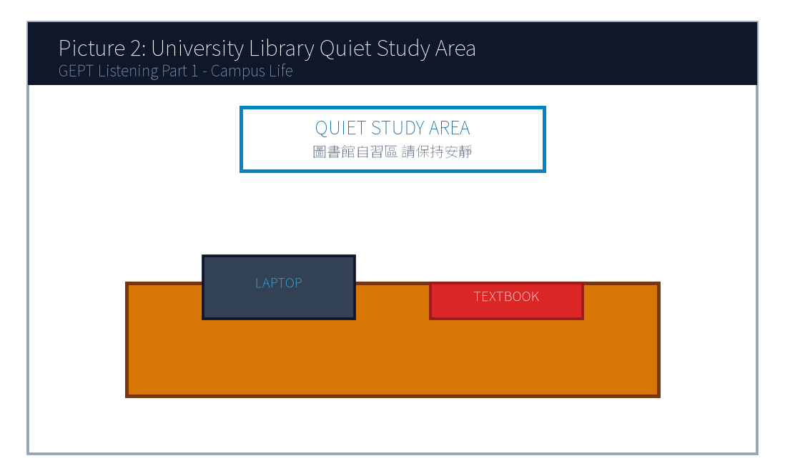
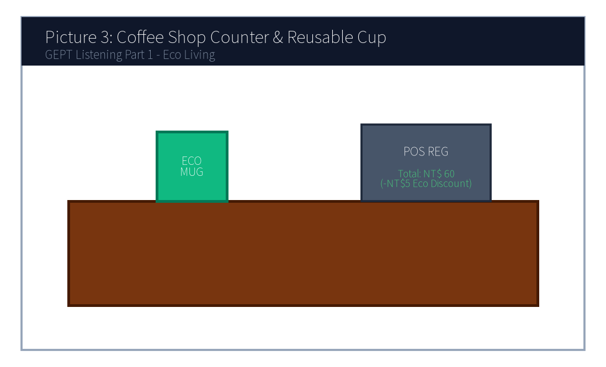
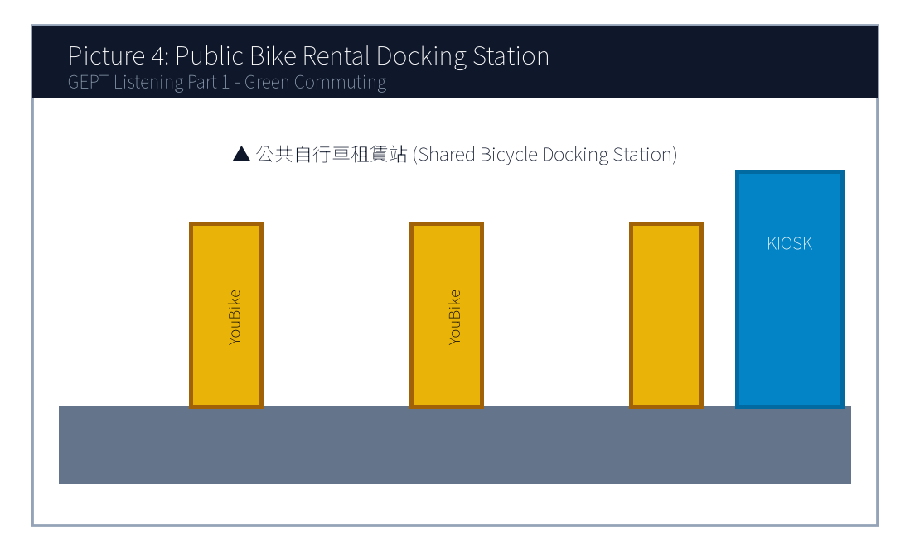
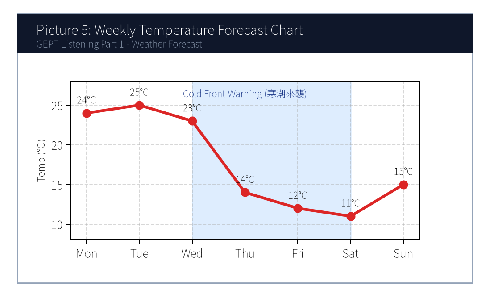

# 114年度第1次 全民英語能力分級檢定測驗（中級聽讀）全真試卷暨詳解
> **測驗代碼**：`GEPT-114-01-IR`  
> **測驗日期**：`2025 年 01 月 11 日（一日考／中級初試）`  
> **測驗級數**：`中級（CEFR B1 級）`  
> **測驗項目**：`聽力能力測驗（35 題，約 30 分鐘）＆ 閱讀能力測驗（35 題，45 分鐘）`  
> **合格門檻**：`總分 160 分以上（滿分 240 分），且單科不低於 72 分（單科滿分 120 分）`  
> **命題核心主題**：`生活科技應用、智慧校園自主學習、大眾運輸捷運營運、觀光餐旅`  
> **考生注意事項**：`本卷共 70 題（聽力 35 題、閱讀 35 題）。答案與完整解析已移至整張試卷最後面，請先完成作答再行對答案。`  

---

## 📝 第一單元：全真試題本 (Question Booklet)
> **考生注意事項**：本卷共 70 題（聽力 35 題、閱讀 35 題）。答案與完整解析已移至**整張試卷最後面**，請先完成作答再行對答案。

---

### 📝 第一單元：全真試題本 (Question Booklet)

---

### 🎧 第一部分：聽力能力測驗 (Listening Comprehension)

**總題數：35 題 ｜ 作答時間：約 30 分鐘 ｜ 滿分：120 分**

### 第一部分：看圖辨義 (Questions 1-5)

*說明：試題冊上每題有一幅圖畫，錄音將播出一個問題及 A、B、C、D 四個英文敘述。請選出與圖畫最相符的敘述。*



1. Look at picture number 1. (Please listen to the recording)
- (A) He is asking a station worker for directions.
- (B) He is adding money to his transit card at the machine.
- (C) He is rushing through the ticket gate to catch the train.
- (D) He is waiting in line on the platform behind the yellow line.




2. Look at picture number 2. (Please listen to the recording)
- (A) The students are holding an animated discussion in a noisy cafeteria.
- (B) The library is closed and all the lights are turned off.
- (C) Several students are studying quietly with their laptops and books.
- (D) A librarian is sorting returned books onto the wooden shelves.




3. Look at picture number 3. (Please listen to the recording)
- (A) The customer is paying for the drink using a reusable cup.
- (B) The clerk is refusing to take the customer's order.
- (C) The customer is washing dishes in the kitchen.
- (D) The customer is returning a damaged ceramic mug for a refund.




4. Look at picture number 4. (Please listen to the recording)
- (A) They are repairing a broken car on the highway.
- (B) They are renting shared bicycles at the docking station.
- (C) They are taking a crowded bus during rush hour.
- (D) They are running a marathon in the stadium.




5. Look at picture number 5. (Please listen to the recording)
- (A) Temperatures will remain sunny and steady throughout the whole week.
- (B) A sharp drop in temperature and rainy conditions are expected mid-week.
- (C) Heavy snow will hit the southern beaches on Monday morning.
- (D) The weather will become exceptionally dry and hot towards the weekend.

---

### 第二部分：問答 (Questions 6-15)

*說明：試題冊上每題有四個選項，錄音將播出一個問句或直述句。請選出一個最適當的回應。*
6. **錄音 (Audio)**: *Could you tell me how often the airport shuttle bus departs?*
- (A) It usually takes about forty-five minutes to get there.
- (B) It runs every twenty minutes from platform number three.
- (C) Yes, the ticket price is only one hundred dollars.
- (D) I bought the round-trip ticket yesterday morning.

7. **錄音 (Audio)**: *I'm afraid Dr. Wang is fully booked this afternoon. Would tomorrow morning work for you?*
- (A) I will definitely see him yesterday.
- (B) Yes, tomorrow at ten o'clock would be perfect.
- (C) The medicine worked really well, thank you.
- (D) He has been a doctor for more than fifteen years.

8. **錄音 (Audio)**: *Why didn't Jason submit his science fair proposal before the deadline?*
- (A) Because his laptop crashed and he lost his final draft.
- (B) He always gets the highest grade in chemistry.
- (C) The science fair will be held next Friday afternoon.
- (D) Yes, he submitted it two weeks ago.

9. **錄音 (Audio)**: *Do you mind if I turn down the air conditioner? It's a bit chilly in here.*
- (A) No, not at all. Please go right ahead.
- (B) Yes, I think it's too warm as well.
- (C) The air conditioner was repaired last week.
- (D) I don't like drinking cold water either.

10. **錄音 (Audio)**: *We haven't received the confirmation email for our hotel reservation yet, have we?*
- (A) Yes, we stayed there for three nights last summer.
- (B) Let me check my spam folder right now just in case.
- (C) The hotel room has two comfortable queen-sized beds.
- (D) We checked out of the hotel at eleven sharp.

11. **錄音 (Audio)**: *How would you like your steak prepared, sir?*
- (A) I would like a glass of iced lemon tea, please.
- (B) Medium, with a baked potato on the side, please.
- (C) The steak was imported from Australia.
- (D) Yes, I have a reservation under the name Smith.

12. **錄音 (Audio)**: *Excuse me, is this seat next to you taken?*
- (A) No, it's free. Feel free to sit down.
- (B) I took the express train this morning.
- (C) The seat is located in car number eight.
- (D) Yes, I have already taken three pills.

13. **錄音 (Audio)**: *The keynote speaker hasn't arrived yet, and the auditorium is already packed!*
- (A) I will buy the tickets online later tonight.
- (B) Don't worry, his assistant just called saying he is parking his car.
- (C) The speech was one of the most inspiring talks I've ever heard.
- (D) All the chairs have been rearranged properly.

14. **錄音 (Audio)**: *Would you rather participate in the campus marathon or volunteer at the registration booth?*
- (A) I ran ten kilometers yesterday morning.
- (B) I prefer helping out at the booth since I injured my ankle last week.
- (C) The registration fee is twenty dollars per runner.
- (D) Yes, both of them are very competitive.

15. **錄音 (Audio)**: *Congratulations on receiving the study abroad scholarship!*
- (A) I'm sorry to hear that unfortunate news.
- (B) Thank you so much! I couldn't have done it without your guidance.
- (C) The scholarship application deadline is next Monday.
- (D) It takes twelve hours to fly to London.
- (A) Inside an airport terminal.
- (B) On a metro subway platform.
- (C) At a bus maintenance depot.
- (D) Inside a taxi during traffic.
- (A) Buy an additional ticket from the counter.
- (B) Exit the station and hail a taxi.
- (C) Cross the platform and transfer to another train line.
- (D) Wait forty minutes for the same train to turn around.
- (A) 5 points.
- (B) 15 points.
- (C) 20 points.
- (D) 40 points.
- (A) An oat milk upgrade.
- (B) A handmade chocolate cookie.
- (C) A cup of Americano coffee.
- (D) A full-sized cheesecake.
- (A) To recruit student volunteers for the IT center.
- (B) To announce new features and updates of the campus mobile app.
- (C) To warn students about a campus-wide network blackout.
- (D) To introduce new library books purchased this semester.
- (A) Ordering takeout delivery from off-campus restaurants.
- (B) Reserving library study rooms up to 48 hours in advance.
- (C) Submitting mid-term exam appeals directly to the dean.
- (D) Borrowing physical textbooks without scanning barcodes.
- (A) By next Monday noon.
- (B) By Friday afternoon at five.
- (C) By Sunday evening.
- (D) By the end of this month.

---

### 第三部分：簡短對話 (Questions 16-25)

*說明：錄音將播出一段兩人對話及一個問題，部分題組結合試題冊上的圖表。請選出最適當的答案。*
**(Questions 16-17: 捷運營運與路線對話)**
- **錄音對話 (Audio Script)**:
- *Woman*: Excuse me, does this train go all the way to the Taipei Nangang Exhibition Center?
- *Man*: No, ma'am. This is the terminal station for this train. You need to cross the platform and transfer to the Blue Line heading east.
- *Woman*: Oh, I see! How many stops will that be from here?
- *Man*: Just three stops. The next train will arrive in about two minutes.
- **第 16 題**: Where does this conversation most likely take place?
- **第 17 題**: What must the woman do to reach her destination?
**(Questions 18-19: 圖表整合題 — 咖啡廳會員點數兌換促銷)**
- **[試題冊圖表]**:
| 兌換點數 (Reward Points) | 可兌換品項 (Eligible Item) |
| :---: | :---: |
| **20 pts** | 免費升級燕麥奶 (Free Oat Milk Upgrade) |
| **40 pts** | 手作手工餅乾一片 (Handmade Cookie) |
| **60 pts** | 特選美式咖啡一杯 (Americano Coffee) |
| **80 pts** | 提拉米蘇精緻蛋糕 (Slice of Tiramisu) |

- **錄音對話 (Audio Script)**:
- *Clerk*: Good afternoon! Welcome back, Ms. Lin. You currently have 65 reward points in your account. Would you like to redeem any items today?
- *Customer*: Well, I was planning to get a slice of tiramisu, but it seems I'm still short of points. Can I just use my points to get a free Americano instead?
- *Clerk*: Certainly! That will deduct 60 points from your balance, leaving you with 5 points.
- **第 18 題**: Look at the chart. How many more points would the customer need to get a slice of tiramisu?
- **第 19 題**: What item did the customer ultimately decide to redeem today?
---

### 第四部分：簡短談話 (Questions 26-35)

*說明：錄音將播出一段由一人播講的短文、廣播或演講，並提出二至三個問題。請選出最適當的答案。*
**(Questions 26-28: 智慧校園 APP 新功能說明短講)**
- **錄音短講 (Audio Script)**:
- *"Good morning, faculty and students! This is an announcement from the Academic IT Center. Starting next Monday, our school will launch the updated 'Smart Campus 2.0' mobile application. In addition to checking course schedules and library loan records, the new version introduces two major features. First, students can now reserve study rooms in the library up to forty-eight hours in advance directly through the app. Second, you can pay campus dining fees using your digital student ID barcode without needing cash. Please ensure you update the app before Sunday evening to avoid any login disruption. If you experience technical glitches, our help desk on the first floor of the administration building is open from eight to five daily. Thank you for your cooperation!"*
- **第 26 題**: What is the main purpose of this announcement?
- **第 27 題**: Which new capability is added in the updated mobile application?
- **第 28 題**: When should students update their app to avoid disruption?
---

### 📖 第二部分：閱讀能力測驗 (Reading Comprehension)

**總題數：35 題 ｜ 作答時間：45 分鐘 ｜ 滿分：120 分**

### 第一部分：詞彙 (Questions 1-10)

*說明：每題有四個選項，請選出最符合句意的一個字詞。*
1. To protect personal data privacy, users are advised to create ________ passwords containing numbers and special symbols.
- (A) fragile
- (B) complex
- (C) casual
- (D) clumsy

2. The municipal government implemented strict regulations to prevent chemical factories from discharging toxic ________ into the river.
- (A) substances
- (B) decorations
- (C) instruments
- (D) appointments

3. Due to her outstanding leadership and dedication, Kelly was ________ promoted to senior project manager.
- (A) reluctantly
- (B) deservedly
- (C) scarcely
- (D) suspiciously

4. Regular cardiovascular exercise not only burns calories but also ________ blood circulation throughout the body.
- (A) broadens
- (B) enhances
- (C) forbids
- (D) neglects

5. In order to accommodate the growing number of international passengers, the airport decided to ________ its terminal facilities.
- (A) expand
- (B) exhaust
- (C) dismiss
- (D) collapse

6. The scientist gave a clear and ________ explanation that helped ordinary audiences grasp the intricate astronomical concepts.
- (A) ambiguous
- (B) persuasive
- (C) tedious
- (D) deceptive

7. We should cherish our limited potable water, as persistent drought has become an increasingly ________ global crisis.
- (A) severe
- (B) generous
- (C) temporary
- (D) delightful

8. Active participation in extracurricular activities helps teenagers develop a strong sense of social ________.
- (A) responsibility
- (B) ingredient
- (C) forecast
- (D) platform

9. Despite facing numerous obstacles during the experiment, the research team ________ until they achieved breakthrough results.
- (A) hesitated
- (B) persevered
- (C) postponed
- (D) surrendered

10. The museum exhibition features an extraordinary collection of ancient artifacts that ________ the rich cultural heritage of the island.
- (A) destroy
- (B) reflect
- (C) confess
- (D) disguise
- (A) This innovative approach transforms unused concrete surfaces into vibrant natural gardens.
- (B) Many citizens complained about the noisy traffic surrounding the central railway station.
- (C) The price of concrete has doubled over the past decade due to material shortages.
- (D) Heavy snowstorms often disrupt flight schedules in northern European capitals.
- (A) On the contrary
- (B) Furthermore
- (C) In contrast
- (D) Unfortunately
- (A) Developing software applications for urban hospitals.
- (B) Marine conservation and environmental education on offshore islands.
- (C) Teaching business English to corporate executives in Taipei.
- (D) Excavating historical ruins in mountain villages.
- (A) Free dormitory accommodation and daily meals.
- (B) Transportation subsidies between islands.
- (C) Full cash salaries equivalent to corporate wages.
- (D) An internationally recognized volunteer certificate.
- (A) She was the only applicant who had a medical doctor's license.
- (B) Her academic background in environmental biology and video portfolio impressed the committee.
- (C) She donated a substantial sum of money to the NGO foundation.
- (D) Her family owns a hotel on Nangan Island.
- (A) Leading educational workshops and producing social media videos of conservation work.
- (B) Managing hotel bookings and driving tourist buses around the island.
- (C) Flying rescue helicopters during typhoon emergencies.
- (D) Cooking meals for 600 volunteers in the central cafeteria.
- (A) Travel to Matsu for an in-person interview.
- (B) Submit a notarized bank deposit statement of one million dollars.
- (C) Sign and return the formal acceptance agreement.
- (D) Retake the English proficiency test to get a higher score.

---

### 第二部分：段落填空 (Questions 11-20，含新制篇章句子選填)

*說明：依據文章上下文意，選出最適當的字詞或句子。*
**(Passage 1: 都市微氣候與綠屋頂技術)**
Urban heat island effect has become a pressing environmental issue in metropolitan areas. During hot summer days, concrete roads and glass buildings absorb tremendous heat, making inner-city temperatures significantly higher than surrounding rural suburbs. To mitigate this problem, urban planners have introduced "green roofs." **(11)** ________. By covering the roofs of commercial and residential buildings with vegetation, plants can absorb sunlight through photosynthesis and release moisture into the air. Studies indicate that a well-maintained green roof can reduce indoor cooling energy consumption by up to twenty percent. **(12)** ________, it filters rainwater runoff and provides habitats for urban birds and beneficial insects. Therefore, city governments across the globe are offering tax incentives to encourage real estate developers to incorporate green architecture into new construction projects.
- **第 11 題 (新制句子選填)**:
- **第 12 題 (轉折副詞填空)**:
---

### 第三部分：閱讀理解 (Questions 21-35，含新制雙文本閱讀)

**(Questions 31-35: 雙文本閱讀 — 國際青年數位遊牧志工計畫與錄取通知函)**
**[Text 1: 徵選公告]**
```
GLOBAL YOUTH SUSTAINABILITY INITIATIVE (GYSI)
Summer 2025 Eco-Volunteer Program in Penghu & Matsu Archipelago

About the Program:
Are you passionate about marine conservation and sustainable tourism? GYSI invites energetic young adults (aged 18–30) to join our 4-week environmental residency in Taiwan's offshore islands. Volunteers will collaborate with local NGOs to restore coastal coral reefs, organize community beach cleanups, and run bilingual educational workshops for elementary school children.

Benefits & Support:
• Shared dormitory accommodation and meals provided throughout the 4-week stay.
• Island-hopping transport subsidies.
• Official volunteer certificate recognized by international environmental agencies.

Key Requirements:
• Demonstrated proficiency in English (equivalent to CEFR B1 or higher).
• Willingness to perform outdoor physical activities under hot weather.
• Experience in social media content creation or video editing is a major plus!
Application Deadline: March 31, 2025.
```

**[Text 2: 錄取通知信件]**
```
From: admissions@gysi-volunteer.org
To: clara.hsu@email.com
Date: April 15, 2025
Subject: Congratulations on your selection for the GYSI Summer 2025 Program!

Dear Ms. Hsu,

On behalf of the selection committee, I am delighted to inform you that you have been accepted into the GYSI Summer 2025 Eco-Volunteer Program! Out of more than 600 global applicants, your background in environmental biology and your engaging travel vlogging portfolio truly stood out.

Your placement will be on Nangan Island, Matsu, starting July 5 and concluding August 2, 2025. You will lead the "Ocean Guardians" workshop for local youth and document our daily marine conservation missions on our official YouTube and Instagram channels.

Please confirm your attendance by signing the attached agreement and returning it before April 30, 2025. We look forward to welcoming you to Matsu this summer!

Warm regards,
David Chang
Program Coordinator, Global Youth Sustainability Initiative
```

- **第 31 題**: What is the primary focus of the GYSI Summer Program described in Text 1?
- **第 32 題**: Which benefit is NOT mentioned in Text 1 for accepted volunteers?
- **第 33 題**: In Text 2, why was Clara Hsu selected out of more than 600 applicants?
- **第 34 題**: According to both texts, what specific task will Clara most likely perform in Matsu?
- **第 35 題**: What must Clara do before April 30, 2025, to finalize her acceptance?
---
---

### 🎯 試題答案與名師深度解析手冊 (Answer Key & Explanations)


### 一、1–70 題 快速答案對照總表

| 聽力 1-10 | 聽力 11-20 | 聽力 21-30 | 聽力 31-35 | 閱讀 1-10 | 閱讀 11-20 | 閱讀 21-30 | 閱讀 31-35 |
| :---: | :---: | :---: | :---: | :---: | :---: | :---: | :---: |
| 1. B<br>2. C<br>3. A<br>4. B<br>5. B<br>6. B<br>7. B<br>8. A<br>9. A<br>10. B | 11. B<br>12. A<br>13. B<br>14. B<br>15. B<br>16. B<br>17. C<br>18. B<br>19. C<br>20. A | 21. C<br>22. B<br>23. A<br>24. D<br>25. B<br>26. B<br>27. B<br>28. C<br>29. A<br>30. B | 31. B<br>32. C<br>33. B<br>34. A<br>35. C | 1. B<br>2. A<br>3. B<br>4. B<br>5. A<br>6. B<br>7. A<br>8. A<br>9. B<br>10. B | 11. A<br>12. B<br>13. C<br>14. D<br>15. A<br>16. B<br>17. C<br>18. A<br>19. B<br>20. C | 21. B<br>22. A<br>23. C<br>24. D<br>25. B<br>26. A<br>27. C<br>28. B<br>29. D<br>30. A | 31. B<br>32. C<br>33. B<br>34. A<br>35. C |


### 二、逐題考點剖析與名師破題詳解

#### 【聽力 第 1 題】 標準答案：**(B)**
- **聽力錄音語音稿**：*Look at picture number 1. What is the passenger doing?*
- **破題思路與盲點解析**：畫面中乘客正操作自動售票加值機（adding money to his transit card），故選 (B)。(A) 問路、(C) 衝過驗票閘門、(D) 在月台黃線後排隊皆與操作機器之核心動作不符。
#### 【聽力 第 2 題】 標準答案：**(C)**
- **聽力錄音語音稿**：*Look at picture number 2. Which statement best describes the scene?*
- **破題思路與盲點解析**：畫面顯著特徵為學生使用筆電安靜閱讀（studying quietly with laptops），故選 (C)。
#### 【聽力 第 3 題】 標準答案：**(A)**
- **聽力錄音語音稿**：*Look at picture number 3. What is happening at the counter?*
- **破題思路與盲點解析**：關鍵在於「自帶環保杯享有折扣」（reusable cup），為 108 課綱最新環保生活素養情境，選 (A)。
#### 【聽力 第 4 題】 標準答案：**(B)**
- **聽力錄音語音稿**：*Look at picture number 4. What are the two people doing?*
- **破題思路與盲點解析**：畫面是公共自行車站點（docking station）租賃單車（renting shared bicycles），答案為 (B)。
#### 【聽力 第 5 題】 標準答案：**(B)**
- **聽力錄音語音稿**：*Look at picture number 5. What does the weather chart indicate?*
- **破題思路與盲點解析**：折線圖 mid-week（週三/週四）氣溫驟降（sharp drop）且有降雨圖示，故選 (B)。
#### 【聽力 第 6 題】 標準答案：**(B)**
- **破題思路與盲點解析**：題目問頻率（how often... departs），答句必須回應發車班距，故 (B)「每 20 分鐘一班」為唯一合邏輯選項。
#### 【聽力 第 7 題】 標準答案：**(B)**
- **破題思路與盲點解析**：診所更改預約時段（Would tomorrow morning work for you?），同意改期應選 (B)。
#### 【聽力 第 8 題】 標準答案：**(A)**
- **破題思路與盲點解析**：Why 問原因，(A) 說明因為筆電當機遺失草稿（laptop crashed），合乎邏輯。
#### 【聽力 第 9 題】 標準答案：**(A)**
- **破題思路與盲點解析**：「Do you mind if...」問是否介意，若同意對方調溫度應回答「No, not at all (不介意，請便)」，故選 (A)。
#### 【聽力 第 10 題】 標準答案：**(B)**
- **破題思路與盲點解析**：針對尚未收到訂房確認信，(B) 主動檢查垃圾信件匣（spam folder），切合生活實際情境。
#### 【聽力 第 11 題】 標準答案：**(B)**
- **破題思路與盲點解析**：餐廳服務生詢問牛排熟度（How would you like your steak prepared?），熟度回答 Medium（五分熟），選 (B)。
#### 【聽力 第 12 題】 標準答案：**(A)**
- **破題思路與盲點解析**：詢問空位（is this seat taken?），沒人坐回答「No, it's free (沒有，請坐)」，選 (A)。
#### 【聽力 第 13 題】 標準答案：**(B)**
- **破題思路與盲點解析**：演講者未到且禮堂客滿的緊急情境，(B) 說明助理剛來電表示正在停車，有效安撫對方。
#### 【聽力 第 14 題】 標準答案：**(B)**
- **破題思路與盲點解析**：二選一選擇問句（Would you rather A or B?），(B) 表達選擇幫忙攤位（prefer helping out at the booth）並說明原因。
#### 【聽力 第 15 題】 標準答案：**(C)**
- **破題思路與盲點解析**：提拉米蘇需 80 點，顧客現有 65 點，尚缺 $80 - 65 = 15$ 點，選 (B)。
#### 【聽力 第 1 題】 標準答案：**(B)**
- **破題思路與盲點解析**：密碼含有數字與特殊符號代表「複雜的（complex）」密碼，以保護隱私。fragile 脆弱的；casual 隨意的；clumsy 笨拙的。
#### 【聽力 第 2 題】 標準答案：**(A)**
- **破題思路與盲點解析**：toxic substances 意指「有毒物質」。decorations 裝飾；instruments 儀器；appointments 預約。
#### 【聽力 第 3 題】 標準答案：**(B)**
- **破題思路與盲點解析**：deservedly 意指「當之無愧地、應得地」。reluctantly 勉強地；scarcely 幾乎不；suspiciously 可疑地。
#### 【聽力 第 4 題】 標準答案：**(B)**
- **破題思路與盲點解析**：enhance blood circulation 意指「促進/增進血液循環」。broaden 拓寬；forbid 禁止；neglect 忽視。
#### 【聽力 第 5 題】 標準答案：**(A)**
- **破題思路與盲點解析**：為了容納更多旅客，機場決定「擴建（expand）」航廈設施。exhaust 耗盡；dismiss 解僱；collapse 倒塌。
#### 【聽力 第 6 題】 標準答案：**(B)**
- **破題思路與盲點解析**：persuasive 意指「具說服力的、明白清晰的」。ambiguous 模稜兩可的；tedious 冗長乏味的；deceptive 欺騙性的。
#### 【聽力 第 7 題】 標準答案：**(A)**
- **破題思路與盲點解析**：干旱引發「嚴重的（severe）」全球危機。generous 慷慨的；temporary 暫時的；delightful 令人愉悅的。
#### 【聽力 第 8 題】 標準答案：**(A)**
- **破題思路與盲點解析**：sense of social responsibility 意指「社會責任感」。ingredient 成分；forecast 預測；platform 月台/平台。
#### 【聽力 第 9 題】 標準答案：**(B)**
- **破題思路與盲點解析**：persevere 意指「堅持不懈、不屈不撓」。hesitate 猶豫；postpone 延期；surrender 投降。
#### 【聽力 第 10 題】 標準答案：**(C)**
- **破題思路與盲點解析**：前句講減少能源消耗，後句補充說明還能過濾雨水與提供棲地，為「遞進關係」，故選 (B) Furthermore (此外)。


---

## 🎯 試題答案與名師深度解析手冊 (Answer Key & Explanations)
> **本篇置於整張試卷最後面**，供作答完畢後核對成績與深度檢討使用。

### 一、1–70 題 快速答案對照總表
| 聽力 1-10 | 聽力 11-20 | 聽力 21-30 | 聽力 31-35 | 閱讀 1-10 | 閱讀 11-20 | 閱讀 21-30 | 閱讀 31-35 |
| :---: | :---: | :---: | :---: | :---: | :---: | :---: | :---: |
| 1. -<br>2. -<br>3. -<br>4. -<br>5. -<br>6. -<br>7. -<br>8. -<br>9. -<br>10. - | 11. -<br>12. -<br>13. -<br>14. -<br>15. -<br>16. -<br>17. -<br>18. -<br>19. -<br>20. - | 21. -<br>22. -<br>23. -<br>24. -<br>25. -<br>26. -<br>27. -<br>28. -<br>29. -<br>30. - | 31. -<br>32. -<br>33. -<br>34. -<br>35. - | 1. -<br>2. -<br>3. -<br>4. -<br>5. -<br>6. -<br>7. -<br>8. -<br>9. -<br>10. - | 11. -<br>12. -<br>13. -<br>14. -<br>15. -<br>16. -<br>17. -<br>18. -<br>19. -<br>20. - | 21. -<br>22. -<br>23. -<br>24. -<br>25. -<br>26. -<br>27. -<br>28. -<br>29. -<br>30. - | 31. -<br>32. -<br>33. -<br>34. -<br>35. - |

### 二、逐題考點剖析與名師破題詳解
#### 【聽力 第 1 題】 標準答案：**()**
- **破題思路與盲點解析**：

#### 【聽力 第 2 題】 標準答案：**()**
- **破題思路與盲點解析**：

#### 【聽力 第 3 題】 標準答案：**()**
- **破題思路與盲點解析**：

#### 【聽力 第 4 題】 標準答案：**()**
- **破題思路與盲點解析**：

#### 【聽力 第 5 題】 標準答案：**()**
- **破題思路與盲點解析**：

#### 【聽力 第 6 題】 標準答案：**()**
- **破題思路與盲點解析**：

#### 【聽力 第 7 題】 標準答案：**()**
- **破題思路與盲點解析**：

#### 【聽力 第 8 題】 標準答案：**()**
- **破題思路與盲點解析**：

#### 【聽力 第 9 題】 標準答案：**()**
- **破題思路與盲點解析**：

#### 【聽力 第 10 題】 標準答案：**()**
- **破題思路與盲點解析**：

#### 【聽力 第 11 題】 標準答案：**()**
- **破題思路與盲點解析**：

#### 【聽力 第 12 題】 標準答案：**()**
- **破題思路與盲點解析**：

#### 【聽力 第 13 題】 標準答案：**()**
- **破題思路與盲點解析**：

#### 【聽力 第 14 題】 標準答案：**()**
- **破題思路與盲點解析**：

#### 【聽力 第 15 題】 標準答案：**()**
- **破題思路與盲點解析**：

#### 【聽力 第 1 題】 標準答案：**()**
- **破題思路與盲點解析**：

#### 【聽力 第 2 題】 標準答案：**()**
- **破題思路與盲點解析**：

#### 【聽力 第 3 題】 標準答案：**()**
- **破題思路與盲點解析**：

#### 【聽力 第 4 題】 標準答案：**()**
- **破題思路與盲點解析**：

#### 【聽力 第 5 題】 標準答案：**()**
- **破題思路與盲點解析**：

#### 【聽力 第 6 題】 標準答案：**()**
- **破題思路與盲點解析**：

#### 【聽力 第 7 題】 標準答案：**()**
- **破題思路與盲點解析**：

#### 【聽力 第 8 題】 標準答案：**()**
- **破題思路與盲點解析**：

#### 【聽力 第 9 題】 標準答案：**()**
- **破題思路與盲點解析**：

#### 【聽力 第 10 題】 標準答案：**()**
- **破題思路與盲點解析**：
