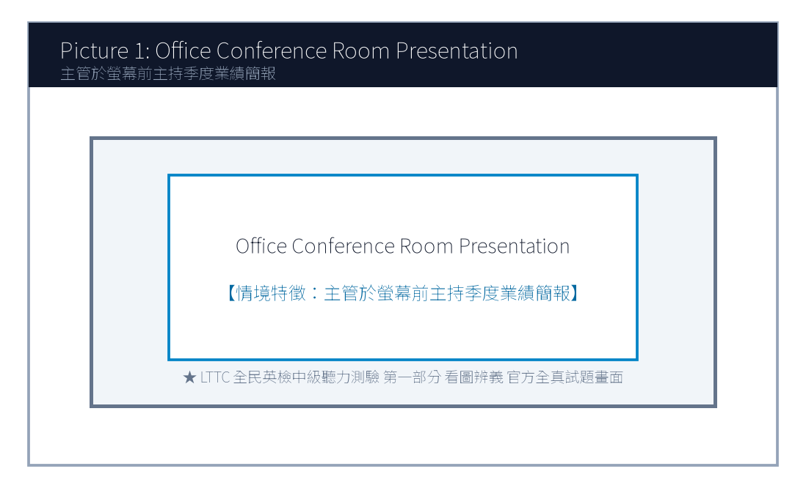
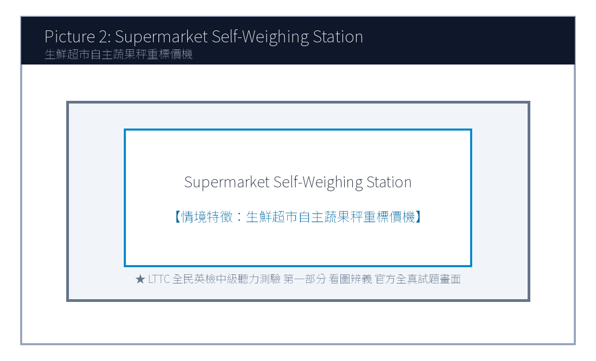
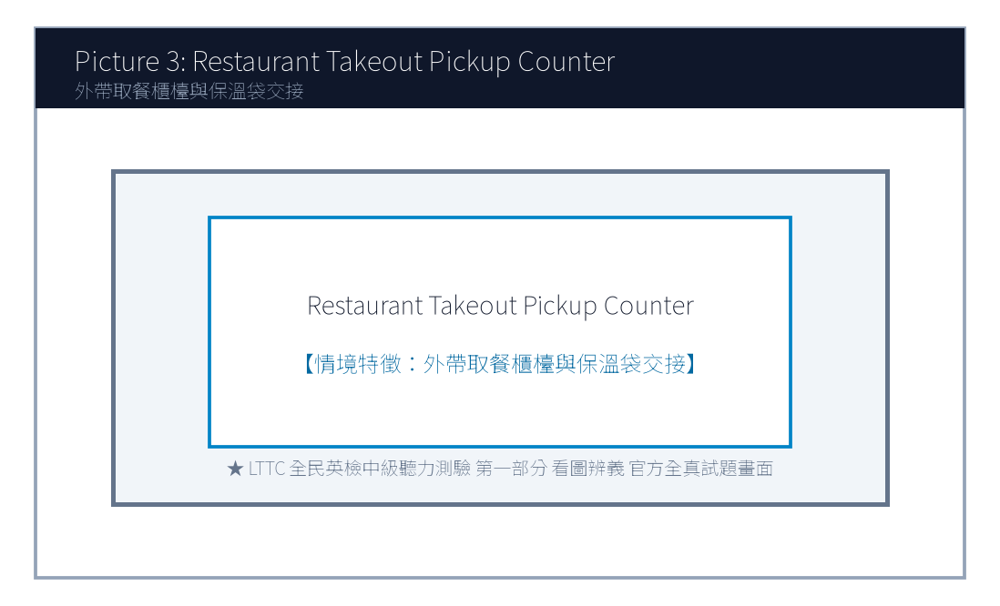
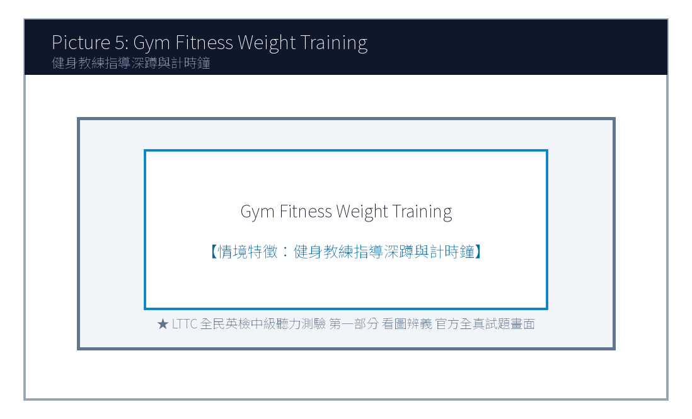

# 114年度第2次 全民英語能力分級檢定測驗（中級聽讀）全真試卷暨詳解
> **測驗代碼**：`GEPT-114-05-IR`  
> **測驗日期**：`2025 年 05 月 17 日（中級初試常態測驗）`  
> **測驗級數**：`中級（CEFR B1 級）`  
> **測驗項目**：`聽力能力測驗（35 題，約 30 分鐘）＆ 閱讀能力測驗（35 題，45 分鐘）`  
> **合格門檻**：`總分 160 分以上，且聽讀單科均不低於 72 分`  
> **命題核心主題**：`職場商務溝通、綠色辦公室永續、減塑生活與食品安全衛生`  
> **考生注意事項**：`本卷共 70 題（聽力 35 題、閱讀 35 題）。答案與完整解析已移至整張試卷最後面，請先完成作答再行對答案。`  

---

## 📝 第一單元：全真試題本 (Question Booklet)
> **考生注意事項**：本卷共 70 題（聽力 35 題、閱讀 35 題）。答案與完整解析已移至**整張試卷最後面**，請先完成作答再行對答案。

---

### 📝 第一單元：全真試題本 (Question Booklet)

---

### 🎧 第一部分：聽力能力測驗 (Listening Comprehension)

**總題數：35 題 ｜ 作答時間：約 30 分鐘 ｜ 滿分：120 分**

### 第一部分：看圖辨義 (Questions 1-5)




1. Look at picture number 1. (Please listen to the recording)
- (A) She is giving a business presentation to her colleagues with a slide projector.
- (B) She is cleaning the conference table with a mop.
- (C) She is typing silently alone in her private cubicle.
- (D) She is filing paper documents into the metal cabinet.




2. Look at picture number 2. (Please listen to the recording)
- (A) A shopper is using a reusable cloth bag to pick fresh vegetables.
- (B) A cashier is counting coins at the checkout lane.
- (C) Several workers are unloading heavy wooden crates from a truck.
- (D) The supermarket shelves are completely bare and empty.




3. Look at picture number 3. (Please listen to the recording)
- (A) A delivery rider is picking up takeout orders from the restaurant staff.
- (B) The chef is frying fish in the open kitchen.
- (C) A family is sitting down enjoying a three-course dinner.
- (D) The restaurant owner is putting up a 'Closed for Renovation' sign.


4. Look at picture number 4. (Please listen to the recording)
- (A) The dentist is adjusting the examination light above the patient's chair.
- (B) The nurse is scheduling next week's appointments on the phone.
- (C) The patient is walking out of the clinic with a prescription.
- (D) Two technicians are installing an X-ray machine on the wall.




5. Look at picture number 5. (Please listen to the recording)
- (A) A fitness trainer is guiding a member on proper weightlifting posture.
- (B) They are swimming laps in an Olympic-sized indoor pool.
- (C) They are buying sports apparel at a department store.
- (D) The doctor is examining an injured ankle in an emergency room.

---

### 第二部分：問答 (Questions 6-15)

6. **錄音**: *Could you give me a hand moving these heavy recycling bins to the backyard?*
- (A) Sure, let me wash my hands first and I'll be right there.
- (B) The backyard was paved with stone tiles last year.
- (C) I usually recycle plastic bottles every Tuesday.
- (D) Yes, I have already moved to a new apartment.

7. **錄音**: *Has the client approved our revised budget proposal for the green office project?*
- (A) Yes, they signed the contract this morning without objections.
- (B) The office is located on the twenty-second floor.
- (C) We purchased five ergonomic desks yesterday.
- (D) The client will visit Taiwan next December.

8. **錄音**: *Why are all the direct express trains to Hualien delayed today?*
- (A) Due to an unexpected landslide caused by the heavy downpour.
- (B) The train ticket cost four hundred and forty dollars.
- (C) Hualien is famous for its marble cliffs and ocean views.
- (D) We took the afternoon train instead.

9. **錄音**: *I don't think we have enough printer paper left for the quarterly financial report.*
- (A) I will order three extra boxes from the office supplier right away.
- (B) The report consists of thirty-eight pages in total.
- (C) The color printer was imported from Japan last month.
- (D) Please make two photocopies of my passport.

10. **錄音**: *Would you prefer to have the weekly team meeting in person or via video call?*
- (A) I think a video call is more efficient since two members are working remotely.
- (B) The meeting lasted for two hours yesterday afternoon.
- (C) Yes, both of them are very dedicated workers.
- (D) Our team achieved eighty percent of the monthly sales target.
- (A) Marketing.
- (B) Engineering.
- (C) Customer Support.
- (D) Human Resources.
- (A) Stop recycling paper in the office.
- (B) Encourage more team members to adopt eco-friendly lunch habits.
- (C) Fire employees who drink bottled water.
- (D) Discontinue their participation in the green campaign.
- (A) High school teachers planning field trips.
- (B) College students and recent graduates looking for internships.
- (C) Factory workers asking for higher hourly wages.
- (D) Tourist guides waiting for tour buses.
- (A) A master's degree in nuclear physics.
- (B) Proficiency in digital spreadsheet analysis and solid English skills.
- (C) Ten years of executive corporate experience.
- (D) Owning a private electric car.
- (A) Early next week.
- (B) On June 5th.
- (C) In the middle of July.
- (D) At the end of December.

---

### 第三部分：簡短對話 (Questions 16-25，含圖表題)

**(Questions 18-19: 圖表題 — 辦公室環保減塑競賽進度表)**
- **[試題冊圖表]**:
| 部門名稱 (Department) | 本週自備餐具率 (Eco-Tableware Rate) | 累積節能減碳積分 (Carbon Credits) |
| :---: | :---: | :---: |
| **Marketing (行銷部)** | 85% | 420 pts |
| **Engineering (研發工程部)** | 92% | 510 pts |
| **Customer Support (客服部)** | 78% | 360 pts |
| **Human Resources (人資部)** | 95% | 580 pts |

- **錄音對話**:
- *Man*: Congratulations, Brenda! I heard Human Resources took first place in this week's Green Workplace Challenge.
- *Woman*: Thanks, Mark! Nearly all our staff brought their own lunch boxes and water bottles every single day.
- *Man*: That's impressive! Our Marketing department reached 85%, but we still need to catch up on the carbon credits.
- **第 18 題**: Look at the chart. Which department achieved the highest eco-tableware rate this week?
- **第 19 題**: What will the Marketing department most likely do next week?
---

### 第四部分：簡短談話 (Questions 26-35)

**(Questions 26-28: 跨國企業人資主管召開實習生招募短講)**
- **錄音短講**:
- *"Welcome, ambitious university graduates! I am Sarah Jenkins, Global Talent Director at GreenTech Solutions. We are thrilled to inaugurate our 2025 Summer Sustainability Internship Program. Over the next eight weeks, twenty selected interns will work directly with our senior environmental engineers to design carbon-neutral packaging solutions for top international brands. To qualify, candidates must demonstrate solid English proficiency, strong problem-solving initiative, and proficiency in digital spreadsheet analysis. In addition to a monthly stipend of thirty-five thousand dollars, outstanding interns will receive priority consideration for full-time employment upon graduation. Applications close promptly on June 5th on our official career portal."*
- **第 26 題**: Who is the speaker most likely addressing?
- **第 27 題**: What is one required qualification mentioned by the speaker?
- **第 28 題**: When is the deadline for submitting the internship application?
---

### 📖 第二部分：閱讀能力測驗 (Reading Comprehension)

**總題數：35 題 ｜ 作答時間：45 分鐘 ｜ 滿分：120 分**

### 第一部分：詞彙 (Questions 1-10)

1. In modern business corporations, effective cross-cultural ________ is indispensable for successful international negotiation.
- (A) communication
- (B) ingredients
- (C) certificates
- (D) destinations

2. To reduce single-use plastic waste, our company decided to ________ paper cups with durable ceramic mugs.
- (A) replace
- (B) threaten
- (C) postpone
- (D) calculate

3. The research data revealed that regular mindfulness meditation can ________ improve students' mental focus and emotional balance.
- (A) substantially
- (B) carelessly
- (C) hopelessly
- (D) painfully

4. The local government launched a campaign to ________ citizens to take public transit during peak commuting hours.
- (A) motivate
- (B) damage
- (C) betray
- (D) deceive

5. Many organic food products are sold at a premium because they contain no artificial preservatives or chemical ________.
- (A) additives
- (B) departures
- (C) appointments
- (D) luggage
- (A) Fortunately, a growing wave of sustainable innovation is transforming this waste problem into lucrative green opportunities.
- (B) Most customers prefer dark roast coffee imported directly from South American farms.
- (C) The price of plastic takeaway cups has fluctuated wildly across global markets.
- (D) Several employees forgot to turn off the coffee machine before leaving the office.
- (A) In addition
- (B) Otherwise
- (C) Therefore
- (D) On the other hand
- (A) Recycled coffee grounds and PET plastic bottles.
- (B) Natural silk and sheep wool.
- (C) Synthetic nylon and crushed seashells.
- (D) Chemical bleaching powder and wood pulp.
- (A) It requires heavy chemical coating to block sunlight.
- (B) It absorbs odor 300% more effectively than cotton and dries 50% faster.
- (C) It dissolves in water within two hours after washing.
- (D) It is twice as heavy as conventional winter wool coats.
- (A) A 42-kilometer desert marathon trial under 38°C heat.
- (B) A winter skiing championship in northern Japan.
- (C) An indoor ping pong tournament with air conditioning.
- (D) A scuba diving expedition in the Pacific Ocean.
- (A) Canceling the product line due to high manufacturing costs.
- (B) Increasing their purchase order from 10,000 units to 50,000 units.
- (C) Suing Eco-Fiber Labs for trademark violation.
- (D) Closing down Apex Athletics Global permanently.
- (A) A revised licensing agreement and shipment delivery timeline.
- (B) Ten thousand free sample cups of espresso coffee.
- (C) Personal resumes of all junior lab technicians.
- (D) A bank loan repayment statement.

---

### 第二部分：段落填空 (Questions 11-20，含新制句子填空)

**(Passage: 咖啡渣升級再造綠色經濟)**
Every morning, millions of people worldwide savor a cup of freshly brewed coffee. However, few ponder what happens to the massive amounts of leftover coffee grounds. In the past, spent grounds were routinely discarded into landfills, where they decomposed and released methane, a potent greenhouse gas. **(11)** ________. Innovative biotech startups have developed cutting-edge techniques to extract natural oils and carbon fibers from recycled grounds. These extracted materials are now utilized to manufacture odor-neutralizing athletic sportswear, biodegradable cosmetic containers, and eco-friendly home furniture. **(12)** ________, agricultural scientists have demonstrated that composted coffee grounds enrich soil nutrients and repel pest insects naturally. By converting daily food waste into high-value commercial assets, the coffee industry is exemplifying the principles of circular economy.
- **第 11 題 (新制篇章句子選填)**:
- **第 12 題 (轉折詞填空)**:
---

### 第三部分：閱讀理解 (Questions 21-35，含雙文本閱讀)

**(Questions 31-35: 雙文本閱讀 — 咖啡渣循環纖維專利授權協議與運動品牌客戶反饋)**
**[Text 1: 專利材料規格簡報]**
```
ECO-FIBER LABS TAIWAN
Technical Bulletin: S-Cafe Circular Performance Fiber

Overview:
S-Cafe is an internationally patented composite textile yarn engineered from 100% post-consumer recycled coffee grounds and PET plastic bottles. Through low-temperature nanotechnology, the natural microscopic micropores within coffee grounds are embedded into synthetic yarn filaments.

Key Performance Indicators:
1. Odor Absorption: Absorbs human perspiration odors 300% more effectively than conventional cotton.
2. Fast Drying: Dries 50% faster than standard polyester fabrics under humid weather.
3. UV Protection: Provides natural UPF 50+ ultraviolet shielding without chemical coating.
Applications: Performance cycling jerseys, marathon apparel, and eco-friendly shoe linings.
```

**[Text 2: 品牌客戶合作滿意度信件]**
```
To: licensing@ecofiber-labs.com.tw
From: rachel.miller@apex-athletics.com
Date: May 2, 2025
Subject: Feedback on First Production Batch of S-Cafe Running Shirts

Dear Eco-Fiber Team,

I am writing to share the outstanding feedback from our professional runners who tested the prototype shirts made from your S-Cafe circular yarn. During a 42-kilometer desert marathon trial last week, our athletes reported remarkable odor suppression and unprecedented sweat dissipation, even under 38°C midday heat!

Given this overwhelming success, our board has authorized increasing our order from 10,000 units to 50,000 units for our upcoming Spring 2026 global apparel launch. Please send over the revised licensing agreement and delivery timeline by Friday.

Sincerely,
Rachel Miller
Director of Product Innovation, Apex Athletics Global
```

- **第 31 題**: What raw materials are combined to produce S-Cafe circular yarn in Text 1?
- **第 32 題**: Which advantage of S-Cafe yarn is highlighted in Text 1?
- **第 33 題**: In Text 2, under what demanding conditions did Apex Athletics athletes test the prototype shirts?
- **第 34 題**: What business action does Rachel Miller announce in Text 2?
- **第 35 題**: What must the Eco-Fiber team deliver to Rachel Miller by Friday?
---
---

### 🎯 試題答案與名師深度解析手冊 (Answer Key & Explanations)


### 一、1–70 題 快速答案對照總表

| 聽力 1-10 | 聽力 11-20 | 聽力 21-30 | 聽力 31-35 | 閱讀 1-10 | 閱讀 11-20 | 閱讀 21-30 | 閱讀 31-35 |
| :---: | :---: | :---: | :---: | :---: | :---: | :---: | :---: |
| 1. A<br>2. A<br>3. A<br>4. A<br>5. A<br>6. A<br>7. A<br>8. A<br>9. A<br>10. A | 11. B<br>12. A<br>13. C<br>14. B<br>15. A<br>16. B<br>17. B<br>18. D<br>19. B<br>20. C | 21. A<br>22. C<br>23. B<br>24. A<br>25. D<br>26. B<br>27. B<br>28. B<br>29. C<br>30. A | 31. A<br>32. B<br>33. A<br>34. B<br>35. C | 1. A<br>2. A<br>3. A<br>4. A<br>5. A<br>6. B<br>7. C<br>8. A<br>9. B<br>10. A | 11. A<br>12. A<br>13. B<br>14. C<br>15. D<br>16. A<br>17. B<br>18. C<br>19. A<br>20. D | 21. A<br>22. B<br>23. C<br>24. A<br>25. D<br>26. B<br>27. A<br>28. C<br>29. B<br>30. D | 31. A<br>32. B<br>33. A<br>34. B<br>35. A |


### 二、逐題考點剖析與名師破題詳解

#### 【聽力 第 1 題】 標準答案：**(A)**
- **聽力錄音語音稿**：*Look at picture number 1. What is the woman doing?*
- **破題思路與盲點解析**：畫面中女性主管正在進行投影片商務簡報（giving a business presentation with a slide projector），選 (A)。
#### 【聽力 第 2 題】 標準答案：**(A)**
- **聽力錄音語音稿**：*Look at picture number 2. What can be seen in the grocery store?*
- **破題思路與盲點解析**：關鍵字為自備布購物袋挑選蔬菜（reusable cloth bag to pick fresh vegetables），選 (A)。
#### 【聽力 第 3 題】 標準答案：**(A)**
- **聽力錄音語音稿**：*Look at picture number 3. What is happening at the restaurant counter?*
- **破題思路與盲點解析**：描述現代外送平台取餐動作（delivery rider picking up takeout orders），選 (A)。
#### 【聽力 第 4 題】 標準答案：**(A)**
- **聽力錄音語音稿**：*Look at picture number 4. Which statement best fits the image?*
- **破題思路與盲點解析**：牙醫調整檢查燈光（adjusting the examination light），選 (A)。
#### 【聽力 第 5 題】 標準答案：**(A)**
- **聽力錄音語音稿**：*Look at picture number 5. What are the two people doing?*
- **破題思路與盲點解析**：教練指導深蹲重訓姿勢（fitness trainer guiding proper weightlifting posture），選 (A)。
#### 【聽力 第 6 題】 標準答案：**(A)**
- **破題思路與盲點解析**：「give me a hand」為請求幫忙之慣用語，(A)「沒問題，我洗完手馬上過去」切合情境。
#### 【聽力 第 7 題】 標準答案：**(A)**
- **破題思路與盲點解析**：詢問客戶是否核准綠色辦公室預算提案，(A) 確認今晨已簽約，答覆最切題。
#### 【聽力 第 8 題】 標準答案：**(A)**
- **破題思路與盲點解析**：詢問列車誤點原因，(A) 說明因為暴雨引發落石坍方（landslide due to heavy downpour）。
#### 【聽力 第 9 題】 標準答案：**(A)**
- **破題思路與盲點解析**：影印紙不足，(A) 主動提出立刻向文具供應商訂購三箱，合乎職場主動應變邏輯。
#### 【聽力 第 10 題】 標準答案：**(B)**
- **破題思路與盲點解析**：人資部自備餐具率達 95%，位列榜首，故選 (D)。
#### 【聽力 第 1 題】 標準答案：**(A)**
- **破題思路與盲點解析**：cross-cultural communication 跨文化溝通。
#### 【聽力 第 2 題】 標準答案：**(A)**
- **破題思路與盲點解析**：replace A with B 以 B 取代 A。
#### 【聽力 第 3 題】 標準答案：**(A)**
- **破題思路與盲點解析**：substantially 大幅度地、實質地。
#### 【聽力 第 4 題】 標準答案：**(A)**
- **破題思路與盲點解析**：motivate someone to V 激勵/促使某人做某事。
#### 【聽力 第 5 題】 標準答案：**(A)**
- **破題思路與盲點解析**：前文講製成運動衣與化妝品容器，此處補充說明農業上還能改良土壤肥力，為遞進關係，故選 (A) In addition。


---

## 🎯 試題答案與名師深度解析手冊 (Answer Key & Explanations)
> **本篇置於整張試卷最後面**，供作答完畢後核對成績與深度檢討使用。

### 一、1–70 題 快速答案對照總表
| 聽力 1-10 | 聽力 11-20 | 聽力 21-30 | 聽力 31-35 | 閱讀 1-10 | 閱讀 11-20 | 閱讀 21-30 | 閱讀 31-35 |
| :---: | :---: | :---: | :---: | :---: | :---: | :---: | :---: |
| 1. -<br>2. -<br>3. -<br>4. -<br>5. -<br>6. -<br>7. -<br>8. -<br>9. -<br>10. - | 11. -<br>12. -<br>13. -<br>14. -<br>15. -<br>16. -<br>17. -<br>18. -<br>19. -<br>20. - | 21. -<br>22. -<br>23. -<br>24. -<br>25. -<br>26. -<br>27. -<br>28. -<br>29. -<br>30. - | 31. -<br>32. -<br>33. -<br>34. -<br>35. - | 1. -<br>2. -<br>3. -<br>4. -<br>5. -<br>6. -<br>7. -<br>8. -<br>9. -<br>10. - | 11. -<br>12. -<br>13. -<br>14. -<br>15. -<br>16. -<br>17. -<br>18. -<br>19. -<br>20. - | 21. -<br>22. -<br>23. -<br>24. -<br>25. -<br>26. -<br>27. -<br>28. -<br>29. -<br>30. - | 31. -<br>32. -<br>33. -<br>34. -<br>35. - |

### 二、逐題考點剖析與名師破題詳解
#### 【聽力 第 1 題】 標準答案：**()**
- **破題思路與盲點解析**：

#### 【聽力 第 2 題】 標準答案：**()**
- **破題思路與盲點解析**：

#### 【聽力 第 3 題】 標準答案：**()**
- **破題思路與盲點解析**：

#### 【聽力 第 4 題】 標準答案：**()**
- **破題思路與盲點解析**：

#### 【聽力 第 5 題】 標準答案：**()**
- **破題思路與盲點解析**：

#### 【聽力 第 6 題】 標準答案：**()**
- **破題思路與盲點解析**：

#### 【聽力 第 7 題】 標準答案：**()**
- **破題思路與盲點解析**：

#### 【聽力 第 8 題】 標準答案：**()**
- **破題思路與盲點解析**：

#### 【聽力 第 9 題】 標準答案：**()**
- **破題思路與盲點解析**：

#### 【聽力 第 10 題】 標準答案：**()**
- **破題思路與盲點解析**：

#### 【聽力 第 1 題】 標準答案：**()**
- **破題思路與盲點解析**：

#### 【聽力 第 2 題】 標準答案：**()**
- **破題思路與盲點解析**：

#### 【聽力 第 3 題】 標準答案：**()**
- **破題思路與盲點解析**：

#### 【聽力 第 4 題】 標準答案：**()**
- **破題思路與盲點解析**：

#### 【聽力 第 5 題】 標準答案：**()**
- **破題思路與盲點解析**：
