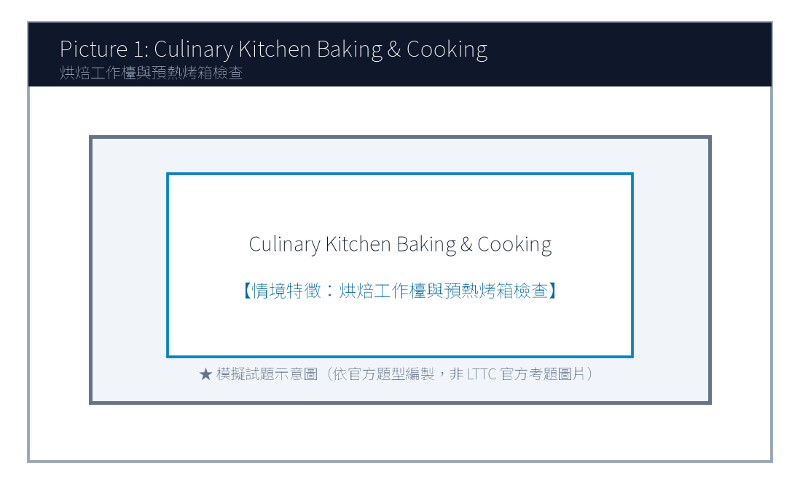
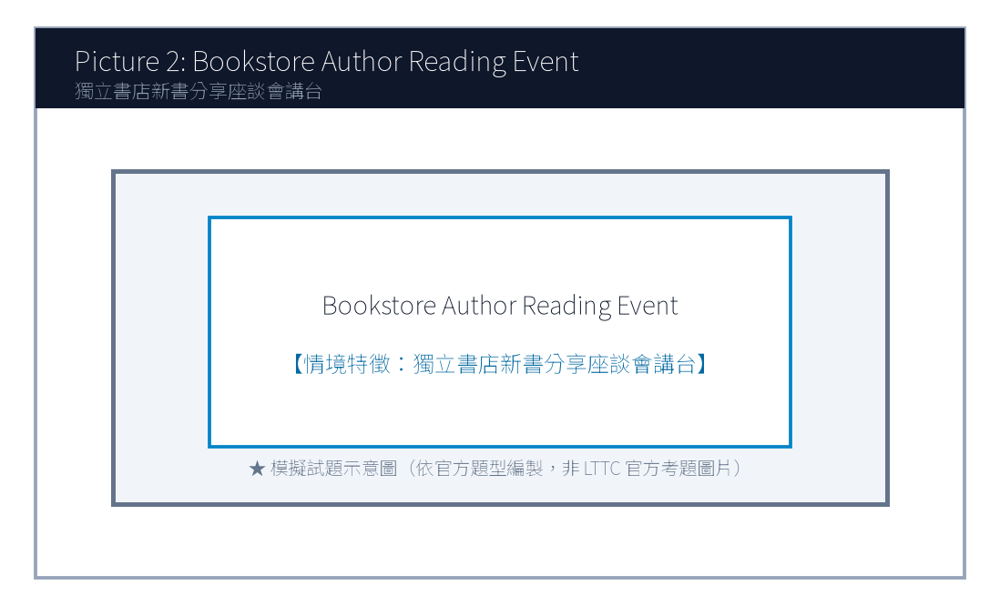
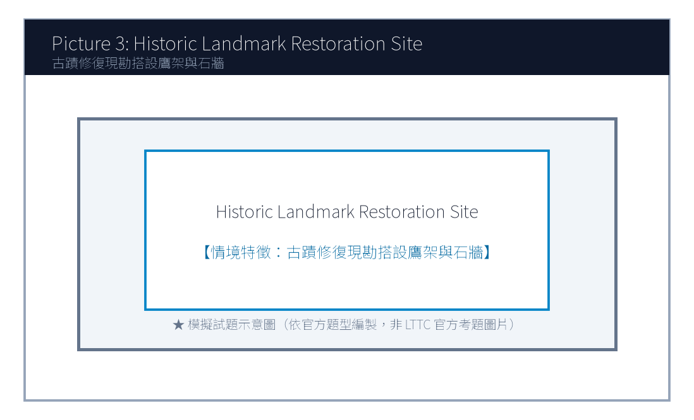
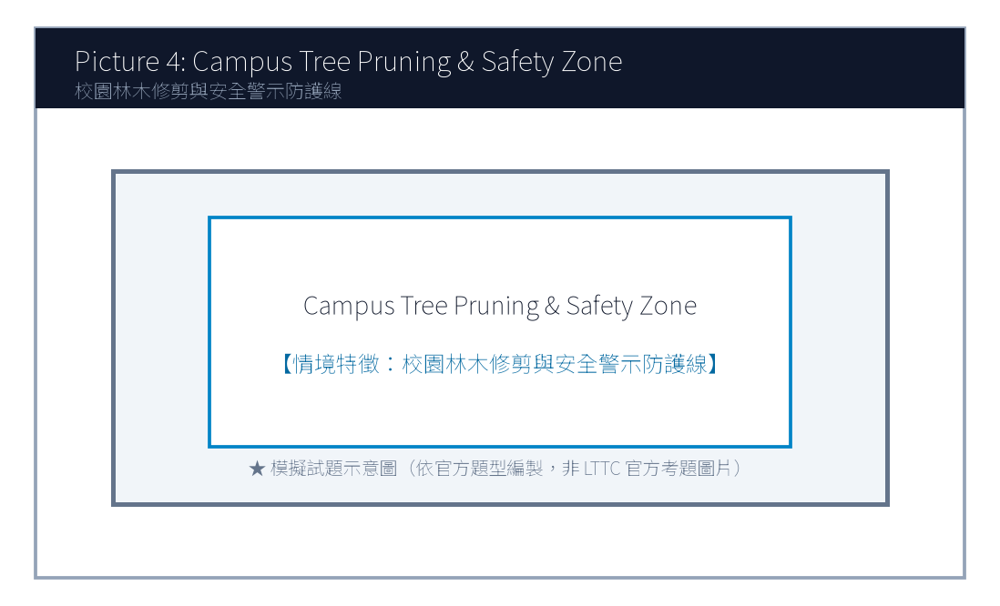
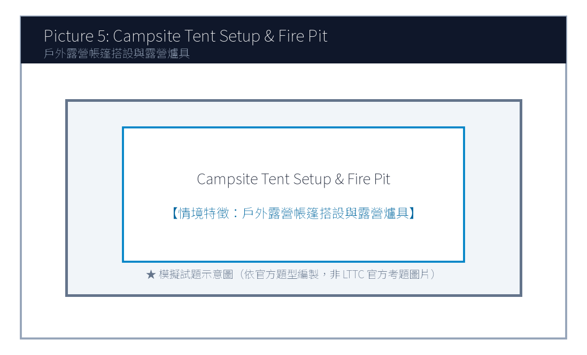

# 114年度第3次 全民英語能力分級檢定測驗（中級聽讀）模擬試題（依官方題型編製）暨詳解
> **測驗代碼**：`GEPT-114-10-IR`  
> **測驗日期**：`2025 年 10 月 18 日（中級初試常態測驗）`  
> **測驗級數**：`中級（CEFR B1 級）`  
> **測驗項目**：`聽力能力測驗（35 題，約 30 分鐘）＆ 閱讀能力測驗（35 題，45 分鐘）`  
> **合格門檻**：`總分 160 分以上，且聽讀單科均不低於 72 分`  
> **命題核心主題**：`傳統文化遺產修復、社群媒體素養與辨識、青年探索教育與心理健康`  
> **考生注意事項**：`本卷共 70 題（聽力 35 題、閱讀 35 題）。答案與完整解析已移至整張試卷最後面，請先完成作答再行對答案。`  

---

## 📝 第一單元：模擬試題本 (Question Booklet)
> **考生注意事項**：本卷共 70 題（聽力 35 題、閱讀 35 題）。答案與完整解析已移至**整張試卷最後面**，請先完成作答再行對答案。

---

### 📝 第一單元：模擬試題本 (Question Booklet)

---

### 🎧 第一部分：聽力能力測驗 (Listening Comprehension)

**總題數：35 題 ｜ 作答時間：約 30 分鐘 ｜ 滿分：120 分**

### 第一部分：看圖辨義 (Questions 1-5)




1. Look at picture number 1. (Please listen to the recording)
- (A) She is guiding an apprentice in traditional indigo fabric dyeing.
- (B) She is selling modern electronic gadgets at a street booth.
- (C) She is painting oil portraits on a blank canvas.
- (D) She is repairing an antique wooden grandfather clock.




2. Look at picture number 2. (Please listen to the recording)
- (A) An author is giving a book talk to an attentive audience.
- (B) A noisy rock concert is performing on a grand stage.
- (C) Construction workers are demolishing the old building walls.
- (D) The bookstore is being liquidated during a clearance sale.




3. Look at picture number 3. (Please listen to the recording)
- (A) He is meticulously restoring an ancient brick fortress wall.
- (B) He is harvesting organic tomatoes in a greenhouse.
- (C) He is conducting an orchestra at an outdoor opera.
- (D) He is driving a yellow bulldozer on a construction site.




4. Look at picture number 4. (Please listen to the recording)
- (A) They are learning digital fact-checking skills in a media literacy class.
- (B) They are playing violent video games during lunch break.
- (C) They are taking a strict mathematics midterm examination.
- (D) They are cleaning the classroom floor with brooms and buckets.




5. Look at picture number 5. (Please listen to the recording)
- (A) They are pitching an outdoor tent together at a campsite.
- (B) They are riding a roller coaster at an amusement park.
- (C) They are checking in at a five-star luxury resort hotel.
- (D) They are rowing a rubber boat down a rapid river.

---

### 第二部分：問答 (Questions 6-15)

6. **錄音**: *Do you know when the registration for the regional speech tournament closes?*
- (A) The deadline is this Friday at five in the afternoon.
- (B) He gave a twenty-minute speech on climate change.
- (C) Yes, I registered my car at the DMV last week.
- (D) The tournament venue has three hundred seats.

7. **錄音**: *How did you manage to verify the authenticity of that online breaking news report?*
- (A) I cross-referenced multiple reputable news agencies and fact-check websites.
- (B) The news anchor was wearing a dark blue suit.
- (C) I watched the news on television yesterday evening.
- (D) Yes, breaking news usually spreads very quickly on social networks.

8. **錄音**: *Would you like me to proofread your English term paper before you hand it in to Professor Lee?*
- (A) That would be wonderful! I'd really appreciate your helpful feedback.
- (B) Professor Lee has been teaching history for twenty years.
- (C) The term paper must be at least twelve pages long.
- (D) I handed in my assignment three weeks ago.
- (A) It was too expensive for their budget.
- (B) It was held on Sunday afternoon instead of Saturday.
- (C) The class was already fully booked.
- (D) The instructor canceled the session due to illness.
- (A) Traditional Indigo Dyeing.
- (B) Old House Clay Pottery.
- (C) Paper Cutting Art.
- (D) Oil Canvas Painting.
- (A) An airline flight attendant.
- (B) An independent bookstore manager.
- (C) A software game programmer.
- (D) A commercial television advertising agent.
- (A) Books are completely free of charge.
- (B) Readers can stumble upon unexpected perspectives not shown by digital algorithms.
- (C) Physical books never need to be dusted or cleaned.
- (D) Reading paper books increases internet download speeds.
- (A) Turn off the ceiling ventilation fans.
- (B) Switch their mobile phones to silent mode.
- (C) Purchase five books at the cash register.
- (D) Leave the bookstore immediately.

---

### 第三部分：簡短對話 (Questions 16-25，含圖表題)

**(Questions 18-19: 圖表題 — 地方文化生活節手作課程課表)**
- **[試題冊圖表]**:
| 工作坊主題 (Workshop) | 授課時間 (Schedule) | 費用與材料包 (Fee & Kit) | 剩餘名額 (Spots Left) |
| :---: | :---: | :---: | :---: |
| **A. 傳統藍染手巾 (Indigo Dyeing)** | 週六 09:30 - 11:30 | NT$ 350 | **2 個名額** |
| **B. 檜木手作筷匙 (Wood Carving)** | 週六 14:00 - 16:30 | NT$ 500 | **已額滿 (FULL)** |
| **C. 老宅泥作盆栽 (Clay Pottery)** | 週日 10:00 - 12:00 | NT$ 400 | **5 個名額** |
| **D. 傳統剪紙藝術 (Paper Cutting)** | 週日 14:00 - 16:00 | NT$ 300 | **8 個名額** |

- **錄音對話**:
- *Woman*: Hi, Eric! I'm signing up for the weekend craft workshops at the cultural center. Do you want to join me this Saturday afternoon for the wood carving class?
- *Man*: I'd love to, but look at the notice board—wood carving is completely sold out!
- *Woman*: Oh, bummer! How about we do the Sunday morning clay pottery class instead? We can make cute miniature plant pots together.
- *Man*: Sounds like a plan! Let's register online right now before those remaining five spots are taken.
- **第 18 題**: Look at the schedule. Why couldn't the speakers join the wood carving class?
- **第 19 題**: Which workshop did the speakers agree to attend together?
---

### 第四部分：簡短談話 (Questions 26-35)

**(Questions 26-28: 獨立書店店長談社群時代實體閱讀的溫度)**
- **錄音短講**:
- *"Good evening, fellow book lovers. Thank you for packing our modest attic salon tonight. In an era dominated by short-form videos and instant algorithmic feeds, people often ask me why I continue running an independent bookstore that sells physical paper volumes. My answer is simple: texture, deliberate pacing, and serendipity. When you browse physical bookshelves, you stumble upon unexpected perspectives that an online algorithm would never recommend to you. Tonight, author Michael Lin will discuss his new novel on rural historical preservation. During the Q&A session, we welcome candid questions, and our cafe bar will provide complimentary floral herbal tea to all registered attendees. Please switch your mobile phones to silent mode now. Let's give Michael a warm round of applause!"*
- **第 26 題**: What is the speaker's main occupation?
- **第 27 題**: According to the speaker, what unique value does physical book browsing offer?
- **第 28 題**: What are attendees requested to do before the talk begins?
---

### 📖 第二部分：閱讀能力測驗 (Reading Comprehension)

**總題數：35 題 ｜ 作答時間：45 分鐘 ｜ 滿分：120 分**

### 第一部分：詞彙 (Questions 1-10)

1. Historical preservationists worked tirelessly to restore the century-old temple to its original architectural ________.
- (A) splendor
- (B) accident
- (C) luggage
- (D) ingredient

2. In the digital age, users should exercise critical judgment and verify information before ________ sensational claims on social media.
- (A) circulating
- (B) drowning
- (C) punishing
- (D) collapsing

3. The mentor encouraged young students to cultivate intellectual ________ by reading widely outside their academic comfort zones.
- (A) curiosity
- (B) hostility
- (C) misery
- (D) ignorance

4. Volunteering in rural community projects allows teenagers to develop genuine ________ for disadvantaged families.
- (A) empathy
- (B) revenge
- (C) cowardice
- (D) allergy

5. The ancient manuscript was so fragile that researchers were required to wear cotton gloves to prevent ________ damage.
- (A) irreversible
- (B) cheerful
- (C) delicious
- (D) convenient
- (A) This pedagogical approach shifts learning from passive indoor classrooms to hands-on natural challenges.
- (B) Many families prefer staying home to watch television dramas during long holiday weekends.
- (C) The cost of purchasing outdoor climbing equipment has increased significantly worldwide.
- (D) High school students are required to wear school uniforms on formal graduation days.
- (A) In fact
- (B) Rather
- (C) Unfortunately
- (D) Despite
- (A) Reviving traditional natural indigo dyeing craftsmanship through sustainable youth entrepreneurship.
- (B) Manufacturing industrial chemical dyes for mass export.
- (C) Selling imported synthetic silk fabrics at discount prices.
- (D) Operating a fast-food chain restaurant in mountain areas.
- (A) They use zero chemical additives and rely entirely on botanical pigments.
- (B) They require all visitors to purchase ten bottles of chemical spray.
- (C) They dump wastewater directly into urban swimming pools.
- (D) They only open for three days every winter.
- (A) By donating 10% of workshop proceeds to senior artisan pension funds and heritage education.
- (B) By building a high-speed railway station near the workshop.
- (C) By giving away free laptops to all university students.
- (D) By paying local residents' household electricity bills.
- (A) Watching the pale green fabric oxidize into deep ocean indigo upon contact with air.
- (B) Hearing a loud explosion during dye boiling.
- (C) Tasting freshly brewed coffee imported from Colombia.
- (D) Seeing a robot automatically sewing winter jackets.
- (A) Demanding a full refund from consumer protection agencies.
- (B) Booking the pottery workshop next spring with her family.
- (C) Opening a rival clothing boutique across the street.
- (D) Filing a complaint against the workshop instructors.

---

### 第二部分：段落填空 (Questions 11-20，含新制句子填空)

**(Passage: 青年探索教育與心理韌性)**
Adolescence is a pivotal stage of life characterized by profound physical and cognitive changes. Faced with demanding academic pressures and peer expectations, many teenagers experience heightened anxiety. Modern educational psychologists advocate for "adventure-based learning" to cultivate psychological resilience. **(11)** ________. By participating in wilderness hiking, rock climbing, and outdoor survival workshops, students are placed in unfamiliar circumstances where they must confront perceived fears and solve unexpected challenges collaboratively. **(12)** ________, empirical studies demonstrate that outdoor experiential learning enhances self-esteem and fosters lifelong interpersonal communication skills. When young adults realize that setbacks are merely stepping stones toward personal growth, they become better equipped to navigate the complexities of modern adulthood.
- **第 11 題 (新制句子選填)**:
- **第 12 題 (轉折詞填空)**:
---

### 第三部分：閱讀理解 (Questions 21-35，含雙文本閱讀)

**(Questions 31-35: 雙文本閱讀 — 地方青創手作藍染品牌宣傳單與顧客回購評語)**
**[Text 1: 藍染工作坊品牌理念]**
```
INDIGO HARBOR WORKSHOP
Preserving Sanxia Traditional Dyeing Heritage

Who We Are:
Founded in 2022 by three returned youth artisans, Indigo Harbor Workshop is dedicated to reviving Taiwan's century-old natural dyeing craftsmanship. We harvest organic Assam indigo plants grown without synthetic pesticides along mountain streams, extracting pure botanical pigments through traditional fermentation.

Our Commitment:
1. Zero Chemical Additives: We use only natural river water, plant ash, and botanical indigo paste.
2. Community Empowerment: 10% of workshop proceeds support senior artisan pension funds and local elementary heritage crafts education.
3. Custom Artisan Keepsakes: Bring your own white cotton shirts, scarves, or canvas tote bags to create bespoke patterns!
Workshop Hours: Tuesday to Sunday, 10:00 - 18:00 (Reservations required for groups of 4+).
```

**[Text 2: 顧客滿意度留言]**
```
Customer Reviews & Testimonials
Reviewer: Karen Chen (Verified Visitor) ★★★★★
Date: October 22, 2025

"I took my two teenage daughters to the 2-hour Shibori scarf workshop last Saturday, and it was hands down the most memorable family activity we've experienced this year! The young instructors were remarkably patient, explaining the chemical fermentation process in a fun and relatable way. Seeing the pale green fabric turn into deep ocean indigo right before our eyes when exposed to air felt like pure magic! Plus, knowing that part of our workshop fee supports local elderly craftspeople makes this keepsake all the more meaningful. We will definitely book the pottery workshop next spring!"
```

- **第 31 題**: What is the primary mission of Indigo Harbor Workshop in Text 1?
- **第 32 題**: Which promise does the workshop make regarding its production process?
- **第 33 題**: How does the workshop support the local community according to Text 1?
- **第 34 題**: In Text 2, what phenomenon during the workshop fascinated Karen Chen and her daughters?
- **第 35 題**: What future action does Karen Chen plan to take based on Text 2?
---
---

### 🎯 試題答案與名師深度解析手冊 (Answer Key & Explanations)


### 一、1–70 題 快速答案對照總表

| 聽力 1-10 | 聽力 11-20 | 聽力 21-30 | 聽力 31-35 | 閱讀 1-10 | 閱讀 11-20 | 閱讀 21-30 | 閱讀 31-35 |
| :---: | :---: | :---: | :---: | :---: | :---: | :---: | :---: |
| 1. A<br>2. A<br>3. A<br>4. A<br>5. A<br>6. A<br>7. A<br>8. A<br>9. B<br>10. C | 11. B<br>12. A<br>13. B<br>14. C<br>15. A<br>16. B<br>17. A<br>18. C<br>19. B<br>20. D | 21. B<br>22. C<br>23. A<br>24. B<br>25. D<br>26. B<br>27. B<br>28. B<br>29. A<br>30. C | 31. B<br>32. A<br>33. B<br>34. C<br>35. A | 1. A<br>2. A<br>3. A<br>4. A<br>5. A<br>6. C<br>7. B<br>8. D<br>9. A<br>10. B | 11. A<br>12. A<br>13. C<br>14. B<br>15. D<br>16. A<br>17. B<br>18. C<br>19. D<br>20. A | 21. B<br>22. A<br>23. C<br>24. D<br>25. B<br>26. A<br>27. C<br>28. B<br>29. D<br>30. A | 31. A<br>32. A<br>33. A<br>34. A<br>35. B |


### 二、逐題考點剖析與名師破題詳解

#### 【聽力 第 1 題】 標準答案：**(A)**
- **聽力錄音語音稿**：*Look at picture number 1. What is the artisan doing?*
- **破題思路與盲點解析**：畫面是傳統藍染工藝教學（guiding traditional indigo fabric dyeing），選 (A)。
#### 【聽力 第 2 題】 標準答案：**(A)**
- **聽力錄音語音稿**：*Look at picture number 2. What is taking place in the bookstore?*
- **破題思路與盲點解析**：獨立書店作家新書分享會（author giving a book talk），選 (A)。
#### 【聽力 第 3 題】 標準答案：**(A)**
- **聽力錄音語音稿**：*Look at picture number 3. What is the specialist doing?*
- **破題思路與盲點解析**：古蹟修復工作（restoring an ancient brick fortress wall），選 (A)。
#### 【聽力 第 4 題】 標準答案：**(A)**
- **聽力錄音語音稿**：*Look at picture number 4. Which activity are the students engaged in?*
- **破題思路與盲點解析**：媒體素養與事實查核課堂（digital fact-checking in media literacy class），選 (A)。
#### 【聽力 第 5 題】 標準答案：**(A)**
- **聽力錄音語音稿**：*Look at picture number 5. What are the young campers doing?*
- **破題思路與盲點解析**：戶外露營搭建帳篷（pitching an outdoor tent at a campsite），選 (A)。
#### 【聽力 第 6 題】 標準答案：**(A)**
- **破題思路與盲點解析**：問報名截止時間（when... closes），回答本週五下午五點，選 (A)。
#### 【聽力 第 7 題】 標準答案：**(A)**
- **破題思路與盲點解析**：詢問如何查證網路新聞真實性，(A) 說明交叉比對多家權威通訊社與事實查核網站。
#### 【聽力 第 8 題】 標準答案：**(B)**
- **破題思路與盲點解析**：兩人協議報名週日上午的「老宅泥作盆栽工作坊 (Clay Pottery)」，選 (B)。
#### 【聽力 第 1 題】 標準答案：**(A)**
- **破題思路與盲點解析**：architectural splendor 建築輝煌風華。
#### 【聽力 第 2 題】 標準答案：**(A)**
- **破題思路與盲點解析**：circulate information 傳播散佈訊息。
#### 【聽力 第 3 題】 標準答案：**(A)**
- **破題思路與盲點解析**：intellectual curiosity 求知好奇心。
#### 【聽力 第 4 題】 標準答案：**(A)**
- **破題思路與盲點解析**：empathy 同理心。
#### 【聽力 第 5 題】 標準答案：**(B)**
- **破題思路與盲點解析**：後文引述實證研究進一步強化論點，選 (A) In fact (事實上)。


---

## 🎯 試題答案與名師深度解析手冊 (Answer Key & Explanations)
> **本篇置於整張試卷最後面**，供作答完畢後核對成績與深度檢討使用。

### 一、1–70 題 快速答案對照總表
| 聽力 1-10 | 聽力 11-20 | 聽力 21-30 | 聽力 31-35 | 閱讀 1-10 | 閱讀 11-20 | 閱讀 21-30 | 閱讀 31-35 |
| :---: | :---: | :---: | :---: | :---: | :---: | :---: | :---: |
| 1. -<br>2. -<br>3. -<br>4. -<br>5. -<br>6. -<br>7. -<br>8. -<br>9. -<br>10. - | 11. -<br>12. -<br>13. -<br>14. -<br>15. -<br>16. -<br>17. -<br>18. -<br>19. -<br>20. - | 21. -<br>22. -<br>23. -<br>24. -<br>25. -<br>26. -<br>27. -<br>28. -<br>29. -<br>30. - | 31. -<br>32. -<br>33. -<br>34. -<br>35. - | 1. -<br>2. -<br>3. -<br>4. -<br>5. -<br>6. -<br>7. -<br>8. -<br>9. -<br>10. - | 11. -<br>12. -<br>13. -<br>14. -<br>15. -<br>16. -<br>17. -<br>18. -<br>19. -<br>20. - | 21. -<br>22. -<br>23. -<br>24. -<br>25. -<br>26. -<br>27. -<br>28. -<br>29. -<br>30. - | 31. -<br>32. -<br>33. -<br>34. -<br>35. - |

### 二、逐題考點剖析與名師破題詳解
#### 【聽力 第 1 題】 標準答案：**()**
- **破題思路與盲點解析**：

#### 【聽力 第 2 題】 標準答案：**()**
- **破題思路與盲點解析**：

#### 【聽力 第 3 題】 標準答案：**()**
- **破題思路與盲點解析**：

#### 【聽力 第 4 題】 標準答案：**()**
- **破題思路與盲點解析**：

#### 【聽力 第 5 題】 標準答案：**()**
- **破題思路與盲點解析**：

#### 【聽力 第 6 題】 標準答案：**()**
- **破題思路與盲點解析**：

#### 【聽力 第 7 題】 標準答案：**()**
- **破題思路與盲點解析**：

#### 【聽力 第 8 題】 標準答案：**()**
- **破題思路與盲點解析**：

#### 【聽力 第 1 題】 標準答案：**()**
- **破題思路與盲點解析**：

#### 【聽力 第 2 題】 標準答案：**()**
- **破題思路與盲點解析**：

#### 【聽力 第 3 題】 標準答案：**()**
- **破題思路與盲點解析**：

#### 【聽力 第 4 題】 標準答案：**()**
- **破題思路與盲點解析**：

#### 【聽力 第 5 題】 標準答案：**()**
- **破題思路與盲點解析**：
