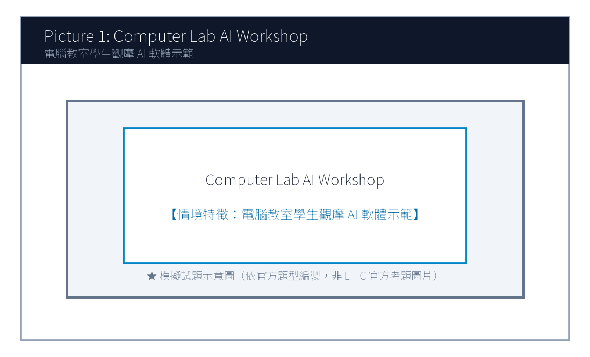
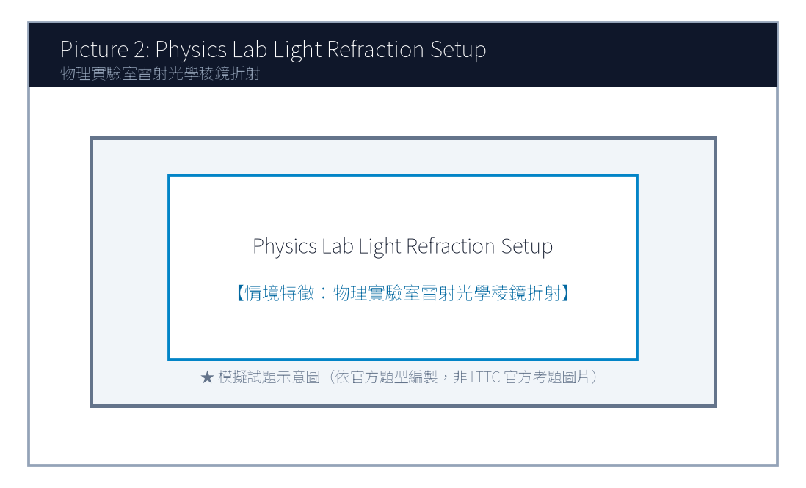
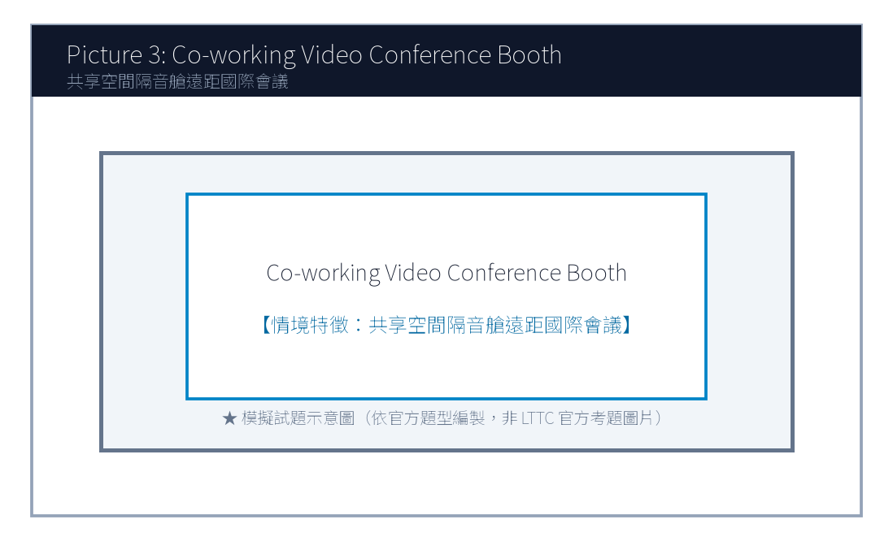
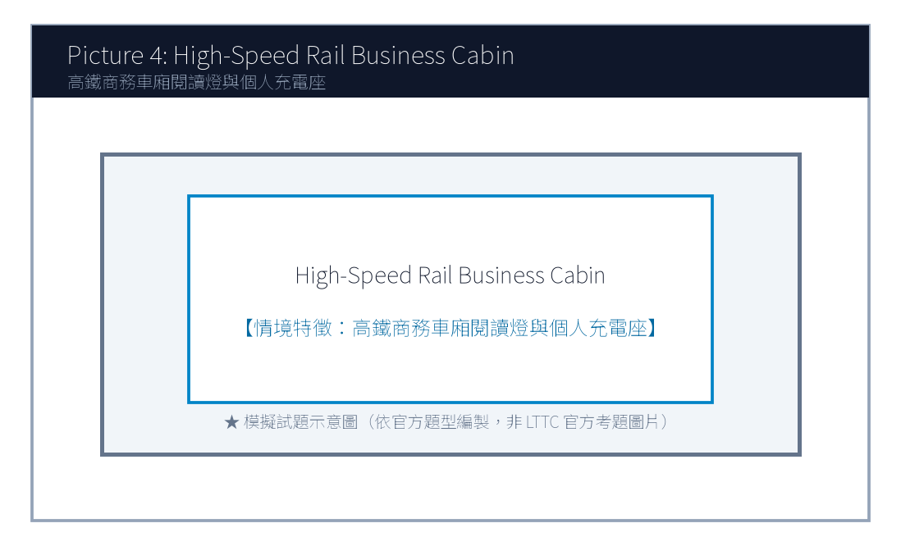
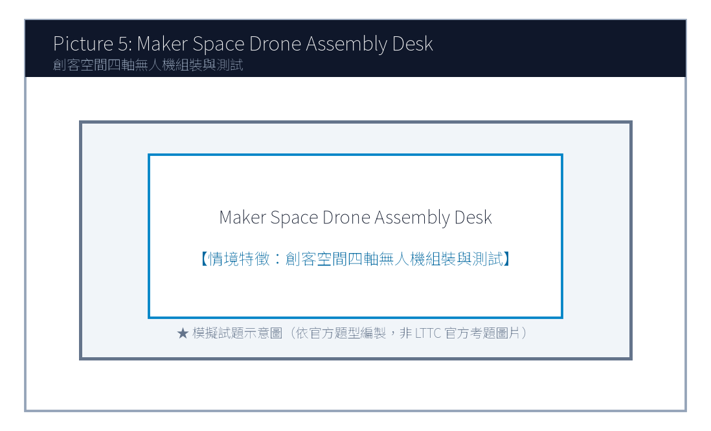

# 115年度第1次 全民英語能力分級檢定測驗（中級聽讀）模擬試題（依官方題型編製）暨詳解
> **測驗代碼**：`GEPT-115-01-IR`  
> **測驗日期**：`2026 年 01 月 10 日（一日考／中級初試）`  
> **測驗級數**：`中級（CEFR B1 級）`  
> **測驗項目**：`聽力能力測驗（35 題，約 30 分鐘）＆ 閱讀能力測驗（35 題，45 分鐘）`  
> **合格門檻**：`總分 160 分以上，且聽讀單科均不低於 72 分`  
> **命題核心主題**：`生成式AI學習輔助工具、遠距協作溝通、跨國生態保育志工服務`  
> **考生注意事項**：`本卷共 70 題（聽力 35 題、閱讀 35 題）。答案與完整解析已移至整張試卷最後面，請先完成作答再行對答案。`  

---

## 📝 第一單元：模擬試題本 (Question Booklet)
> **考生注意事項**：本卷共 70 題（聽力 35 題、閱讀 35 題）。答案與完整解析已移至**整張試卷最後面**，請先完成作答再行對答案。

---

### 📝 第一單元：模擬試題本 (Question Booklet)

---

### 🎧 第一部分：聽力能力測驗 (Listening Comprehension)

**總題數：35 題 ｜ 作答時間：約 30 分鐘 ｜ 滿分：120 分**

### 第一部分：看圖辨義 (Questions 1-5)




1. Look at picture number 1. (Please listen to the recording)
- (A) He is using an AI-powered language app to practice English pronunciation.
- (B) He is dismantling a broken computer motherboard with screwdrivers.
- (C) He is playing an online fantasy role-playing game with friends.
- (D) He is watching an animated cartoon without headphones.




2. Look at picture number 2. (Please listen to the recording)
- (A) Volunteers are guiding newborn sea turtle hatchlings safely toward the ocean waves.
- (B) Tourists are riding jet skis dangerously close to the rocky cliffs.
- (C) Fishermen are casting large commercial nylon nets into deep water.
- (D) Construction cranes are dumping heavy rocks onto the sand.




3. Look at picture number 3. (Please listen to the recording)
- (A) Remote professionals of diverse nationalities are collaborating on a virtual project.
- (B) The building is undergoing emergency fire evacuation drills.
- (C) A chef is cooking meals in a commercial restaurant kitchen.
- (D) Several dancers are rehearsing ballet movements in front of mirrors.




4. Look at picture number 4. (Please listen to the recording)
- (A) He is reviewing business documents on a tablet inside a high-speed train.
- (B) He is sleeping soundly on an airplane overnight flight.
- (C) He is driving a cargo truck along a winding mountain highway.
- (D) He is checking luggage at an international cruise terminal.




5. Look at picture number 5. (Please listen to the recording)
- (A) He is demonstrating the obstacle avoidance features of an aerial drone to visitors.
- (B) He is selling second-hand bicycles at a flea market.
- (C) He is repairing a broken television antenna on a residential roof.
- (D) He is painting warning stripes on a airport runway.

---

### 第二部分：問答 (Questions 6-15)

6. **錄音**: *Have you updated your generative AI writing assistant to the latest security patch?*
- (A) Yes, the system updated automatically overnight while charging.
- (B) I bought the computer for nine hundred dollars.
- (C) The security guard patrols the building every evening.
- (D) Artificial intelligence was invented several decades ago.

7. **錄音**: *I'm having trouble connecting to the company's virtual private network from my home office.*
- (A) Let me ping the IT support team to reset your remote login credentials.
- (B) The company headquarters was founded in 1998.
- (C) I enjoy drinking hot tea while studying at home.
- (D) Your home office has three large windows.

8. **錄音**: *Would you consider volunteering for the sea turtle conservation program in Penghu this summer?*
- (A) Absolutely! I've always wanted to contribute to marine wildlife preservation.
- (B) Penghu is famous for its delicious fresh seafood restaurants.
- (C) The flight from Taipei to Makung takes approximately fifty minutes.
- (D) Turtles can live for more than one hundred years in captivity.
- (A) Because their webinar registration exceeded the 150-participant limit.
- (B) Because the company went bankrupt and needed a cheaper tier.
- (C) Because the Pro plan was canceled by the software vendor.
- (D) Because they wanted to delete all their cloud recordings.
- (A) Basic.
- (B) Pro.
- (C) Business.
- (D) Enterprise.
- (A) To sell luxury beach resort tickets to tourists.
- (B) To provide essential ethical guidelines and instructions for incoming sea turtle volunteers.
- (C) To complain about severe water pollution caused by commercial shipping.
- (D) To teach cooking methods for traditional Penghu seafood dishes.
- (A) It drains the batteries of smartphones too quickly.
- (B) White light disorients baby turtles, causing them to crawl toward inland roads instead of the sea.
- (C) Local fishermen dislike bright lights along the coast.
- (D) Flashlights might attract aggressive sharks to shallow waters.
- (A) By six a.m.
- (B) By noon.
- (C) By nine p.m.
- (D) By midnight.

---

### 第三部分：簡短對話 (Questions 16-25，含圖表題)

**(Questions 18-19: 圖表題 — 遠距辦公軟體功能方案比較表)**
- **[試題冊圖表]**:
| 方案名稱 (Plan Tier) | 最大連線人數 (Max Participants) | 雲端錄影空間 (Cloud Recording) | 月費 (Monthly Fee) |
| :---: | :---: | :---: | :---: |
| **Basic (基礎免費版)** | 50 人 | 無 (None) | **Free** |
| **Pro (專業版)** | 150 人 | 10 GB | **NT$ 450** |
| **Business (商務團隊版)** | 300 人 | 100 GB (含即時AI聽寫) | **NT$ 850** |
| **Enterprise (企業客製版)** | 1000 人 | 無限制 (Unlimited) | 專案報價 |

- **錄音對話**:
- *Manager*: Helen, our marketing webinar next week already has 220 registered attendees. Our current Pro plan only supports up to 150 people!
- *Helen*: You're right, sir. We definitely need to upgrade before Thursday. Should we go for the Business plan? It allows up to 300 participants and even includes AI real-time meeting transcription.
- *Manager*: Excellent recommendation! That will allow us to share meeting transcripts with attendees who cannot tune in live. Let's upgrade immediately.
- **第 18 題**: Look at the chart. Why did the team decide to upgrade from the Pro plan?
- **第 19 題**: Which plan did the manager approve to upgrade to?
---

### 第四部分：簡短談話 (Questions 26-35)

**(Questions 26-28: 國際海洋保育基金會志工線上行前培訓短講)**
- **錄音短講**:
- *"Welcome, volunteers! My name is Dr. Amanda Thorne from the International Marine Wildlife Sanctuary. First off, thank you for committing four weeks of your summer to our Penghu Archipelago Sea Turtle Rescue Mission. Before arriving on the island, there are three critical ethical guidelines every team member must adhere to. First, never touch or pick up nesting mother turtles or newly hatched babies with bare hands, as human scents and skin bacteria can disorient them and cause fatal infections. Second, maintain a strict red-light-only policy on beaches after dark, as white smartphone flashlights cause hatchlings to crawl away from the ocean toward inland roads. Third, upload your daily monitoring logs into our encrypted field app by nine p.m. every evening. Our island orientation starts next Monday at eight sharp at the Makung Community Center. See you all in Penghu!"*
- **第 26 題**: What is the primary purpose of this talk?
- **第 27 題**: Why are volunteers strictly forbidden from using white flashlights on beaches at night?
- **第 28 題**: When must daily monitoring logs be submitted each evening?
---

### 📖 第二部分：閱讀能力測驗 (Reading Comprehension)

**總題數：35 題 ｜ 作答時間：45 分鐘 ｜ 滿分：120 分**

### 第一部分：詞彙 (Questions 1-10)

1. While artificial intelligence tools can generate fluent texts rapidly, human editors remain ________ to verify factual accuracy and ethical standards.
- (A) indispensable
- (B) clumsy
- (C) fragile
- (D) tedious

2. Remote employees must cultivate high self-________ to maintain productivity while working without direct supervision.
- (A) discipline
- (B) appointment
- (C) ingredient
- (D) receipt

3. The wildlife sanctuary relies heavily on generous public ________ to finance its marine rescue operations.
- (A) donations
- (B) collisions
- (C) emergencies
- (D) departures

4. The research paper demonstrates that learning a second language helps ________ one's cultural horizons significantly.
- (A) broaden
- (B) damage
- (C) forbid
- (D) neglect

5. In response to customer feedback, the software developer released a patch to fix several minor ________ in the mobile application.
- (A) glitches
- (B) necklaces
- (C) vegetables
- (D) platforms
- (A) Many educators fear that uncritical reliance on automated text generators will erode students' fundamental writing competencies.
- (B) Campus cafeteria prices have stabilized due to recent agricultural harvest yields.
- (C) Online shopping packages are usually delivered by postal couriers within two business days.
- (D) Swimming in outdoor pools during thunderstorms is strictly prohibited by safety regulations.
- (A) Specifically
- (B) On the contrary
- (C) Nevertheless
- (D) Otherwise
- (A) Demolishing all old stone houses to build high-rise steel apartments.
- (B) Revitalizing traditional granite stone houses in Matsu through youth entrepreneurship and adaptive reuse.
- (C) Selling historic public properties to foreign real estate speculators.
- (D) Closing down tourism operations in Lienchiang County.
- (A) Up to NT$ 800,000 renovation subsidy and a 3-year rent-free lease.
- (B) Free private jet transportation across international borders.
- (C) Lifetime exemption from all national income taxes.
- (D) Cash bonuses of five million dollars with no inspection.
- (A) A chemical fertilizer processing plant.
- (B) A bilingual storytelling inn and ceramic handicraft studio.
- (C) An underground casino and nightclub.
- (D) An industrial automobile assembly workshop.
- (A) The load-bearing granite walls and fir-wood truss structures must remain completely intact.
- (B) All ancient stone walls must be painted neon pink.
- (C) The house must be replaced with modern aluminum siding.
- (D) He must destroy all wooden doors and windows.
- (A) Before April 10, 2026.
- (B) At the end of December 2026.
- (C) In the middle of next year.
- (D) Before yesterday noon.

---

### 第二部分：段落填空 (Questions 11-20，含新制句子填空)

**(Passage: 生成式 AI 寫作倫理與學術誠信)**
The proliferation of large language models has fundamentally transformed writing and learning practices. With a few simple text prompts, students can generate comprehensive essays, computer code, and creative stories within seconds. While these cutting-edge digital assistants offer unprecedented efficiency, they also raise pressing ethical concerns regarding academic integrity. **(11)** ________. Plagiarism detection tools frequently struggle to distinguish between purely machine-generated prose and authentic human thought. Consequently, leading universities worldwide are enacting clear instructional guidelines that define permitted applications of artificial intelligence. **(12)** ________, educators emphasize that AI should serve as an auxiliary brain-storming partner rather than an effortless substitute for critical inquiry. By learning how to cross-examine and verify algorithmically generated assertions, students develop deeper intellectual autonomy.
- **第 11 題 (新制句子選填)**:
- **第 12 題 (轉折詞填空)**:
---

### 第三部分：閱讀理解 (Questions 21-35，含雙文本閱讀)

**(Questions 31-35: 雙文本閱讀 — 連江馬祖老宅機能復新青年創業徵件計畫與政府文化資產審核公文)**
**[Text 1: 馬祖連江縣老宅延壽機能復新青創徵件公告]**
```
LIENCHIANG COUNTY CULTURAL AFFAIRS BUREAU
2026 Matsu Traditional Stone House Adaptive Reuse Initiative

Program Objective:
To revitalize traditional Eastern Fujian granitic stone houses in Qinbi and Fuxing villages, the Lienchiang County Government invites innovative youth entrepreneurship proposals. We encourage applicants to transform underutilized historic residences into community cultural spaces, boutique hostels, or artisan handicraft studios while preserving authentic wooden beam architectures.

Grant & Financial Support:
• Up to NT$ 800,000 subsidy for structural safety retrofitting and interior eco-friendly renovation.
• 3-year rent-free lease on designated public heritage properties.
• Technical consultancy from professional architects and water-soil conservation specialists.

Eligibility & Submission:
Applicants aged 20–45 with proven experience in heritage preservation, hospitality, or digital marketing. Proposals must be submitted via the official county portal by February 28, 2026.
```

**[Text 2: 連江縣政府審查核定函]**
```
LIENCHIANG COUNTY GOVERNMENT - OFFICIAL NOTIFICATION
Document No.: Fu-Wen-Zi-115002488
Date: March 20, 2026

To: Lin Chia-Wei (Founder, Matsu Stone Whisper Cultural Studio)
Subject: Approval of Project Proposal under the 2026 Traditional Stone House Initiative

Dear Mr. Lin,

We are pleased to inform you that your proposal titled "Revitalizing Qinbi Village House No. 12 into a Bilingual Storytelling Inn & Ceramic Studio" has received official approval from our review committee.

Key Approval Terms:
1. Approved Grant Amount: NT$ 750,000, disbursed in three installments upon phased inspection.
2. Building Preservation Protocol: The load-bearing granite walls and fir-wood truss structures must remain intact in accordance with Article 15 of the Matsu Cultural Heritage Regulations.
3. Commencement Milestone: Physical restoration must commence before May 15, 2026, with public opening targeted for October 2026.

Please visit the Cultural Affairs Bureau on Nangan Island before April 10, 2026, to finalize the lease agreement. Congratulations on your successful application!

Sincerely,
Chen Po-Chun
Director, Lienchiang County Cultural Affairs Bureau
```

- **第 31 題**: What is the primary purpose of the initiative described in Text 1?
- **第 32 題**: Which financial incentive is offered to approved applicants in Text 1?
- **第 33 題**: In Text 2, what business concept did Lin Chia-Wei propose for Qinbi Village House No. 12?
- **第 34 題**: According to Text 2, what strict preservation condition must Mr. Lin adhere to during renovation?
- **第 35 題**: When must Mr. Lin visit the Cultural Affairs Bureau on Nangan Island to finalize the lease?
---
---

### 🎯 試題答案與名師深度解析手冊 (Answer Key & Explanations)


### 一、1–70 題 快速答案對照總表

| 聽力 1-10 | 聽力 11-20 | 聽力 21-30 | 聽力 31-35 | 閱讀 1-10 | 閱讀 11-20 | 閱讀 21-30 | 閱讀 31-35 |
| :---: | :---: | :---: | :---: | :---: | :---: | :---: | :---: |
| 1. A<br>2. A<br>3. A<br>4. A<br>5. A<br>6. A<br>7. A<br>8. A<br>9. C<br>10. B | 11. B<br>12. A<br>13. B<br>14. D<br>15. A<br>16. B<br>17. C<br>18. A<br>19. C<br>20. B | 21. C<br>22. A<br>23. D<br>24. B<br>25. C<br>26. B<br>27. B<br>28. C<br>29. A<br>30. D | 31. B<br>32. A<br>33. B<br>34. C<br>35. B | 1. A<br>2. A<br>3. A<br>4. A<br>5. A<br>6. B<br>7. C<br>8. D<br>9. A<br>10. B | 11. A<br>12. A<br>13. C<br>14. B<br>15. D<br>16. A<br>17. B<br>18. C<br>19. A<br>20. D | 21. B<br>22. C<br>23. A<br>24. D<br>25. B<br>26. A<br>27. C<br>28. B<br>29. D<br>30. A | 31. B<br>32. A<br>33. B<br>34. A<br>35. A |


### 二、逐題考點剖析與名師破題詳解

#### 【聽力 第 1 題】 標準答案：**(A)**
- **聽力錄音語音稿**：*Look at picture number 1. What is the student doing?*
- **破題思路與盲點解析**：學生使用 AI 語言軟體練習發音（AI-powered language app to practice pronunciation），選 (A)。
#### 【聽力 第 2 題】 標準答案：**(A)**
- **聽力錄音語音稿**：*Look at picture number 2. What can be seen on the beach?*
- **破題思路與盲點解析**：志工護送剛孵化海龜入海（volunteers guiding sea turtle hatchlings toward waves），選 (A)。
#### 【聽力 第 3 題】 標準答案：**(A)**
- **聽力錄音語音稿**：*Look at picture number 3. What is happening in the co-working space?*
- **破題思路與盲點解析**：跨國遠距工作者協同合作（remote professionals collaborating on a virtual project），選 (A)。
#### 【聽力 第 4 題】 標準答案：**(A)**
- **聽力錄音語音稿**：*Look at picture number 4. Which statement accurately describes the passenger?*
- **破題思路與盲點解析**：高鐵車廂內使用平板處理商務（reviewing business documents on a tablet on high-speed train），選 (A)。
#### 【聽力 第 5 題】 標準答案：**(A)**
- **聽力錄音語音稿**：*Look at picture number 5. What is the demonstrator doing?*
- **破題思路與盲點解析**：示範空拍無人機避障功能（demonstrating obstacle avoidance features of aerial drone），選 (A)。
#### 【聽力 第 6 題】 標準答案：**(A)**
- **破題思路與盲點解析**：詢問是否已更新安全修補程式，(A) 說明夜間充電時系統已自動更新。
#### 【聽力 第 7 題】 標準答案：**(A)**
- **破題思路與盲點解析**：遠距連線故障（having trouble connecting to VPN），(A) 主動協助通知 IT 部門重設登入憑證。
#### 【聽力 第 8 題】 標準答案：**(C)**
- **破題思路與盲點解析**：主管核准升級為 Business 方案（NT$ 850，上限 300 人），選 (C)。
#### 【聽力 第 1 題】 標準答案：**(A)**
- **破題思路與盲點解析**：indispensable 不可或缺的。
#### 【聽力 第 2 題】 標準答案：**(A)**
- **破題思路與盲點解析**：self-discipline 自律。
#### 【聽力 第 3 題】 標準答案：**(A)**
- **破題思路與盲點解析**：donations 捐款。
#### 【聽力 第 4 題】 標準答案：**(A)**
- **破題思路與盲點解析**：broaden one's horizons 開拓眼界。
#### 【聽力 第 5 題】 標準答案：**(A)**
- **破題思路與盲點解析**：後句具體闡述大學指引的核心觀點（AI 應作為腦力激盪夥伴），故選 (A) Specifically (具體而言)。


---

## 🎯 試題答案與名師深度解析手冊 (Answer Key & Explanations)
> **本篇置於整張試卷最後面**，供作答完畢後核對成績與深度檢討使用。

### 一、1–70 題 快速答案對照總表
| 聽力 1-10 | 聽力 11-20 | 聽力 21-30 | 聽力 31-35 | 閱讀 1-10 | 閱讀 11-20 | 閱讀 21-30 | 閱讀 31-35 |
| :---: | :---: | :---: | :---: | :---: | :---: | :---: | :---: |
| 1. -<br>2. -<br>3. -<br>4. -<br>5. -<br>6. -<br>7. -<br>8. -<br>9. -<br>10. - | 11. -<br>12. -<br>13. -<br>14. -<br>15. -<br>16. -<br>17. -<br>18. -<br>19. -<br>20. - | 21. -<br>22. -<br>23. -<br>24. -<br>25. -<br>26. -<br>27. -<br>28. -<br>29. -<br>30. - | 31. -<br>32. -<br>33. -<br>34. -<br>35. - | 1. -<br>2. -<br>3. -<br>4. -<br>5. -<br>6. -<br>7. -<br>8. -<br>9. -<br>10. - | 11. -<br>12. -<br>13. -<br>14. -<br>15. -<br>16. -<br>17. -<br>18. -<br>19. -<br>20. - | 21. -<br>22. -<br>23. -<br>24. -<br>25. -<br>26. -<br>27. -<br>28. -<br>29. -<br>30. - | 31. -<br>32. -<br>33. -<br>34. -<br>35. - |

### 二、逐題考點剖析與名師破題詳解
#### 【聽力 第 1 題】 標準答案：**()**
- **破題思路與盲點解析**：

#### 【聽力 第 2 題】 標準答案：**()**
- **破題思路與盲點解析**：

#### 【聽力 第 3 題】 標準答案：**()**
- **破題思路與盲點解析**：

#### 【聽力 第 4 題】 標準答案：**()**
- **破題思路與盲點解析**：

#### 【聽力 第 5 題】 標準答案：**()**
- **破題思路與盲點解析**：

#### 【聽力 第 6 題】 標準答案：**()**
- **破題思路與盲點解析**：

#### 【聽力 第 7 題】 標準答案：**()**
- **破題思路與盲點解析**：

#### 【聽力 第 8 題】 標準答案：**()**
- **破題思路與盲點解析**：

#### 【聽力 第 1 題】 標準答案：**()**
- **破題思路與盲點解析**：

#### 【聽力 第 2 題】 標準答案：**()**
- **破題思路與盲點解析**：

#### 【聽力 第 3 題】 標準答案：**()**
- **破題思路與盲點解析**：

#### 【聽力 第 4 題】 標準答案：**()**
- **破題思路與盲點解析**：

#### 【聽力 第 5 題】 標準答案：**()**
- **破題思路與盲點解析**：
