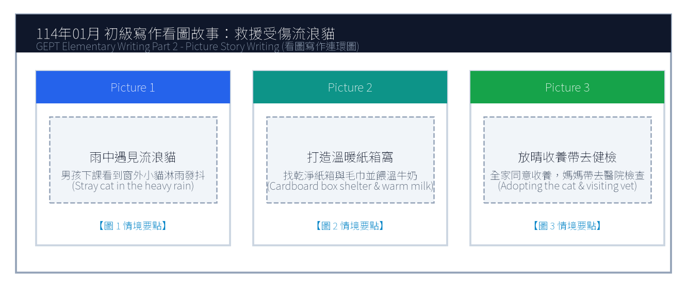
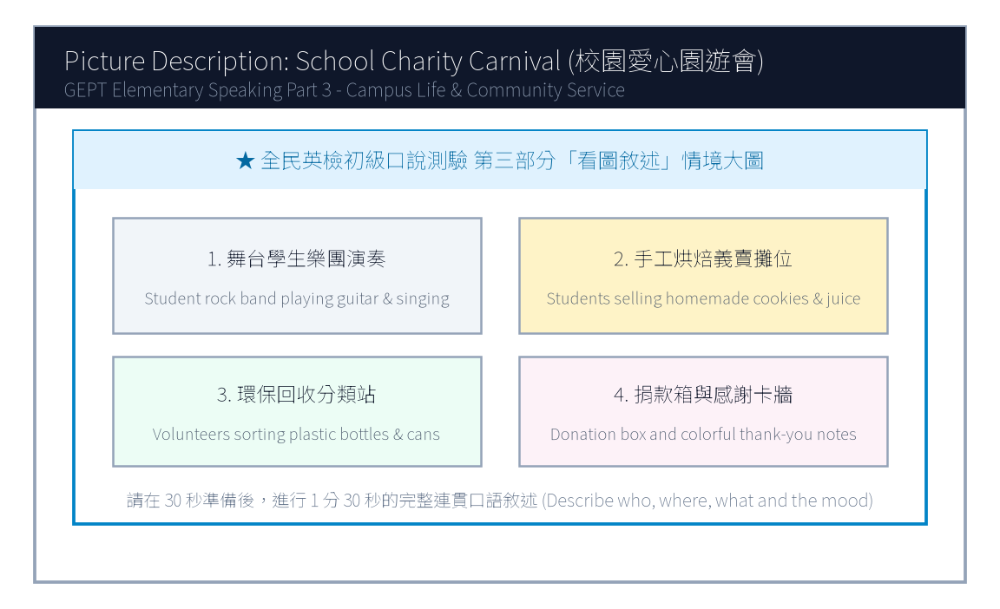

# 114年度第1次 全民英檢初級說寫測驗（第二試／一日考）模擬試題（依官方題型編製）暨詳解

> **測驗代碼**：`GEPT-E-114-01-SW`  
> **測驗日期**：`2025 年 01 月 11 日（一日考說寫複試）`  
> **測驗級數**：`初級（CEFR A2 級）`  
> **測驗項目**：`寫作能力測驗（40 分鐘）＆ 口說能力測驗（約 10 分鐘）`  
> **合格門檻**：`寫作達 70 分以上且口說達 80 分以上（均達 4 級分以上始發證書）`  
> **核心主題**：`校園愛心關懷、救援流浪貓、校園愛心園遊會義賣、健康運動習慣`  

---

## 📝 第一單元：模擬試題本 (Question Booklet)
> **考生注意事項**：本卷分為寫作能力測驗與口說能力測驗。所有題目上方已附專屬圖表，答案與滿分示範講稿已移至**整張試卷最後面**，請先完成作答再行翻閱核對。

### ✍️ 第一部分：寫作能力測驗 (Writing Test - 40分鐘)
#### 第一單元：單句寫作 (Questions 1–15)
1. Amy plays badminton with her sister every Saturday morning. (改為否定句)
作答區：_________________________________________________________________

2. Mr. Brown bought a brand new hybrid car last weekend. (依畫線部分 a brand new hybrid car 照原級造原問句)
作答區：_________________________________________________________________

3. Learning English by watching foreign animation movies is really enjoyable. (用 It... 開頭改寫句子)
作答區：_________________________________________________________________

4. The brave firefighter saved the little girl from the burning apartment. (改為被動語態)
作答區：_________________________________________________________________

5. Peter was too tired to finish his math assignment last night. (用 so... that... 改寫句子)
作答區：_________________________________________________________________

6. on the desk / left / her English dictionary / Jenny / yesterday afternoon
作答區：_________________________________________________________________

7. more exercise / healthy / to do / it is important / to stay
作答區：_________________________________________________________________

8. because / the outdoor concert / canceled / was / it rained heavily
作答區：_________________________________________________________________

9. a pair of / bought / fashionable sneakers / at the mall / David
作答區：_________________________________________________________________

10. how to / could you / tell me / the train station / get to / ?
作答區：_________________________________________________________________

11. Eric likes playing basketball. / His brother enjoys playing basketball, too. (用 both... and... 合併)
作答區：_________________________________________________________________

12. The weather was extremely cold yesterday. / We still went hiking in the national park. (用 Although 合併)
作答區：_________________________________________________________________

13. That is the famous writer. / She wrote the best-selling science fiction novel. (用 who 合併)
作答區：_________________________________________________________________

14. Linda studied very hard for the final exam. / She wanted to get good grades. (用 in order to 合併)
作答區：_________________________________________________________________

15. The blue smartphone is five thousand dollars. / The white smartphone is eight thousand dollars. (用 cheaper than 合併)
作答區：_________________________________________________________________

#### 第二單元：段落寫作 (Question 16 看圖短文寫作)

16. 請依據下列三幅連環圖畫內容，寫一篇約 50 字的短文故事。請發揮你的想像力，敘述事情的發生、經過與結果。

### 🎙️ 第二部分：口說能力測驗 (Speaking Test - 約10分鐘)
#### 第一單元：朗讀短文 (Questions 1–2)
**Question 1 朗讀短文**：
> Passage 1: Welcome to Taipei International Youth Camp. During the next five days, you will meet friends from all over the world. Please remember to wear your name badge and be on time for every exciting activity. If you need any assistance, our friendly staff members in blue shirts are always ready to help you.

**Question 2 朗讀短文**：
> Passage 2: Bees are small but they play a vital role in our ecosystem. Every sunny morning, worker bees fly from flower to flower collecting nectar and pollinating fruit trees. Without their tireless hard work, many vegetables and fruits would not grow. Protecting nature helps these tiny creatures survive.

#### 第二單元：回答問題 (Questions 3–12)
- 3. What is your favorite season of the year, and why do you like it?
- 4. How do you usually travel to school every morning?
- 5. What kind of movies do you enjoy watching the most?
- 6. What do you usually do when you feel stressed out?
- 7. Tell me about your best friend at school.
- 8. If you have a holiday tomorrow, where would you like to go?
- 9. How often do you help your parents with household chores?
- 10. What is your dream job in the future?
- 11. Do you prefer reading paper books or using digital tablets?
- 12. What was the happiest event that happened to you recently?

#### 第三單元：看圖敘述 (Question 13 情境大圖口語敘述)

13. 請仔細觀察圖片，有 30 秒的準備時間。之後請在 1 分 30 秒內，根據圖片內容作一完整連貫的口語敘述。

---

## 🎯 試題答案與名師深度解析手冊 (Answer Key & Explanations)
> **本篇置於整張試卷最後面**，供作答完畢後核對成績、滿分範文觀摩與考點診斷使用。

### 一、寫作能力測驗 標準答案與滿分解析
#### 【第一部分：單句寫作 1–15 題標準答案】
- **第 1 題**：`Amy does not play badminton with her sister every Saturday morning.`
- **第 2 題**：`What did Mr. Brown buy last weekend?`
- **第 3 題**：`It is really enjoyable to learn English by watching foreign animation movies.`
- **第 4 題**：`The little girl was saved by the brave firefighter from the burning apartment.`
- **第 5 題**：`Peter was so tired that he could not finish his math assignment last night.`
- **第 6 題**：`Jenny left her English dictionary on the desk yesterday afternoon.`
- **第 7 題**：`It is important to do more exercise to stay healthy.`
- **第 8 題**：`The outdoor concert was canceled because it rained heavily.`
- **第 9 題**：`David bought a pair of fashionable sneakers at the mall.`
- **第 10 題**：`Could you tell me how to get to the train station?`
- **第 11 題**：`Both Eric and his brother like playing basketball.`
- **第 12 題**：`Although the weather was extremely cold yesterday, we still went hiking in the national park.`
- **第 13 題**：`That is the famous writer who wrote the best-selling science fiction novel.`
- **第 14 題**：`Linda studied very hard for the final exam in order to get good grades.`
- **第 15 題**：`The blue smartphone is cheaper than the white smartphone.`

#### 【第二部分：段落看圖寫作 5 級分滿分範文】
> **滿分範文**：
> "One rainy afternoon, Ken heard a weak cry outside his living room window and found a shivering stray cat drenched in the storm. Feeling deeply worried, he brought the little cat indoors, gently dried its fur with a soft towel, and fed it warm milk in a clean cardboard box. The next sunny morning, his mother agreed to adopt the sweet kitten and took it to the veterinarian for a complete health check. Ken was overjoyed to give this homeless animal a loving family."

### 二、口說能力測驗 滿分示範講稿與逐字稿
#### 【第二單元：回答問題 10 題 滿分示範答句】
- **3. What is your favorite season of the year, and why do you like it?**
  - *滿分示範*："My favorite season is autumn because the weather is pleasantly cool and breezy. I love riding my bicycle in the park with my friends without sweating a lot."
- **4. How do you usually travel to school every morning?**
  - *滿分示範*："I usually take the MRT to school because the station is just a five-minute walk from my apartment. It is very punctual and convenient."
- **5. What kind of movies do you enjoy watching the most?**
  - *滿分示範*："I enjoy watching superhero action movies because the visual special effects are astonishing, and the storylines always teach us to be brave and help others."
- **6. What do you usually do when you feel stressed out?**
  - *滿分示範*："When I feel stressed, I listen to cheerful pop music and go for a brisk jog in the park. Sweating helps clear my mind and makes me feel energetic again."
- **7. Tell me about your best friend at school.**
  - *滿分示範*："My best friend is Leo. We have known each other since elementary school. He is very kind, humorous, and always patient in explaining difficult math questions to me."
- **8. If you have a holiday tomorrow, where would you like to go?**
  - *滿分示範*："If I have a day off tomorrow, I would love to visit the National Palace Museum. I want to see the precious ancient jade artifacts and taste delicious dumplings nearby."
- **9. How often do you help your parents with household chores?**
  - *滿分示範*："I help my parents clean the dining table and wash dishes every evening. On weekends, I also help vacuum the living room carpet and take out the recycling bins."
- **10. What is your dream job in the future?**
  - *滿分示範*："My dream job is to become an environmental veterinarian because I have always loved animals and want to protect wildlife from extinction."
- **11. Do you prefer reading paper books or using digital tablets?**
  - *滿分示範*："I prefer reading real paper books because holding a book feels wonderful and it does not strain my eyes like bright digital screens do."
- **12. What was the happiest event that happened to you recently?**
  - *滿分示範*："The happiest event recently was winning first place in our school's science fair. My teammates and I worked hard for two months, so we were thrilled to receive the trophy."

#### 【第三單元：看圖敘述 90 秒完整連貫滿分講稿】
> **滿分講稿**：
> "This lively picture shows our annual school charity carnival taking place on a bright sunny afternoon. In the upper left corner, four energetic student musicians are performing rock songs on the stage, attracting a cheering crowd of classmates. Right beside the stage, several student volunteers are selling delicious homemade cookies and fresh fruit juice at a decorated booth. Near the entrance, two responsible students wearing green vests are carefully sorting plastic bottles and aluminum cans into recycling bins to keep the campus clean. Meanwhile, many teachers and parents are dropping donations into the charity box to support local children in need. Everyone looks genuinely cheerful, and the whole campus is filled with laughter and festive spirit."

### 三、本卷核心考點單字與高頻實用片語表
| 考點單字／片語 | 詞性 | 中文核心語意 | 生活情境搭配例句 |
| :---: | :---: | :---: | :---: |
| **badminton** | n. | 羽毛球 | play badminton with friends every weekend |
| **firefighter** | n. | 消防員 | the brave firefighter saved the trapped resident |
| **hybrid car** | n. | 油電混合車 | drive an eco-friendly hybrid car to save gasoline |
| **assignment** | n. | 作業、任務 | finish the science assignment before the deadline |
| **stray cat** | n. | 流浪貓 | rescue a shivering stray cat in the alley |
| **veterinarian** | n. | 獸醫師 (常簡稱 vet) | take the sick puppy to the veterinarian for a shot |
| **charity carnival** | n. | 愛心慈善園遊會 | raise money for orphans at the charity carnival |
| **ecosystem** | n. | 生態系統 | protect bees to maintain a balanced ecosystem |
| **volunteer** | n./v. | 志工；自願 | work as a hospital volunteer on Saturday mornings |
| **punctual** | adj. | 準時的 | The MRT system in Taiwan is extremely punctual. |
