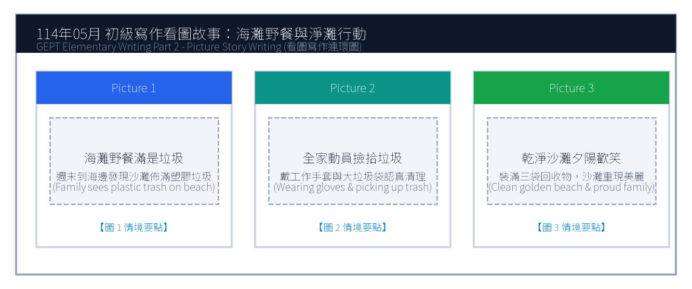
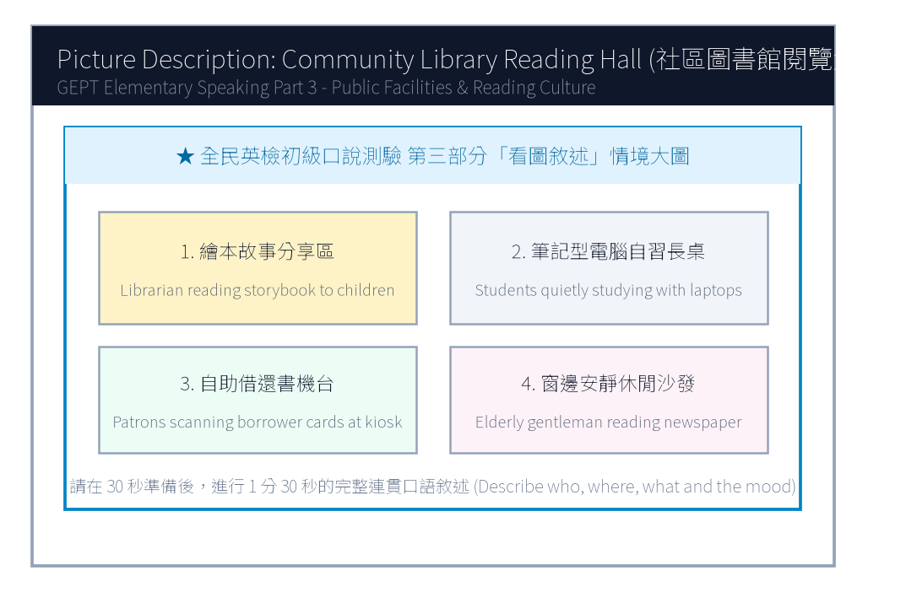

# 114年度第2次 全民英檢初級說寫測驗（第二試常態初試）模擬試題（依官方題型編製）暨詳解

> **測驗代碼**：`GEPT-E-114-05-SW`  
> **測驗日期**：`2025 年 05 月 17 日（初級複試常態測驗）`  
> **測驗級數**：`初級（CEFR A2 級）`  
> **測驗項目**：`寫作能力測驗（40 分鐘）＆ 口說能力測驗（約 10 分鐘）`  
> **合格門檻**：`寫作達 70 分以上且口說達 80 分以上（均達 4 級分以上始發證書）`  
> **核心主題**：`社區環保淨灘、海灘守護行動、假日圖書館閱讀文化、健康生活`  

---

## 📝 第一單元：模擬試題本 (Question Booklet)
> **考生注意事項**：本卷分為寫作能力測驗與口說能力測驗。所有題目上方已附專屬圖表，答案與滿分示範講稿已移至**整張試卷最後面**，請先完成作答再行翻閱核對。

### ✍️ 第一部分：寫作能力測驗 (Writing Test - 40分鐘)
#### 第一單元：單句寫作 (Questions 1–15)
1. Many tourists visit Kenting National Park during summer vacation. (改為否定句)
作答區：_________________________________________________________________

2. Susan practices playing the piano for two hours every day. (依畫線部分 for two hours 造原問句)
作答區：_________________________________________________________________

3. To sort garbage into different recycling bins is very important. (用 It is... 改寫)
作答區：_________________________________________________________________

4. Edison invented the world's first practical electric light bulb. (改為被動語態)
作答區：_________________________________________________________________

5. The math puzzle was so difficult that none of the students could solve it. (用 too... to... 改寫)
作答區：_________________________________________________________________

6. a clean cloth bag / brought / to the supermarket / Mrs. Lin / yesterday
作答區：_________________________________________________________________

7. good for / eating fresh fruits / your health / and vegetables / is
作答區：_________________________________________________________________

8. turned off / before leaving / all the computers / the students / the classroom
作答區：_________________________________________________________________

9. in the park / saw / three playful puppies / running happily / we
作答區：_________________________________________________________________

10. the famous museum / is / from our hotel / how far / ?
作答區：_________________________________________________________________

11. Tina woke up early this morning. / She missed the first school bus anyway. (用 Although 合併)
作答區：_________________________________________________________________

12. Mark likes drinking green tea. / His father prefers drinking black tea. (用 while 或 but 合併)
作答區：_________________________________________________________________

13. The boy won the gold medal in swimming. / He has trained hard for five years. (用 who 合併)
作答區：_________________________________________________________________

14. We went to the public library. / We wanted to borrow some travel books. (用 to 或 in order to 合併)
作答區：_________________________________________________________________

15. An airplane is faster than a high-speed train. / A high-speed train is faster than a car. (用 fastest 合併)
作答區：_________________________________________________________________

#### 第二單元：段落寫作 (Question 16 看圖短文寫作)

16. 請依據下列三幅海灘淨灘連環圖畫，寫一篇約 50 字的短文故事，敘述全家前往海灘野餐時發現垃圾並主動淨灘的過程。

### 🎙️ 第二部分：口說能力測驗 (Speaking Test - 約10分鐘)
#### 第一單元：朗讀短文 (Questions 1–2)
**Question 1 朗讀短文**：
> Passage 1: Welcome to the Green Ocean Aquarium. We invite you to explore the fascinating underwater world. Please do not tap on the glass or use flash photography, as bright lights may frighten our sea turtles and penguins. Enjoy your magical journey with our lovely ocean creatures.

**Question 2 朗讀短文**：
> Passage 2: Drinking enough water every day is essential for good health. Water helps regulate our body temperature, aids digestion, and keeps our skin hydrated. Health experts suggest carrying a reusable water bottle so you can drink water regularly throughout the busy school day.

#### 第二單元：回答問題 (Questions 3–12)
- 3. What kind of breakfast do you usually eat in the morning?
- 4. Where is your favorite place to study?
- 5. How do you usually celebrate your birthday?
- 6. Do you enjoy listening to music while doing homework?
- 7. Tell me about your favorite school teacher.
- 8. What sport do you like to play the most?
- 9. How do you usually spend your Sunday afternoons?
- 10. What would you do if you lost your transit pass?
- 11. Do you like cooking or baking at home?
- 12. What country would you like to travel to in the future?

#### 第三單元：看圖敘述 (Question 13 情境大圖口語敘述)

13. 請仔細觀察圖片，有 30 秒的準備時間。之後請在 1 分 30 秒內，根據圖中圖書館閱覽大廳的情境作一完整連貫的口述敘述。

---

## 🎯 試題答案與名師深度解析手冊 (Answer Key & Explanations)
> **本篇置於整張試卷最後面**，供作答完畢後核對成績、滿分範文觀摩與考點診斷使用。

### 一、寫作能力測驗 標準答案與滿分解析
#### 【第一部分：單句寫作 1–15 題標準答案】
- **第 1 題**：`Many tourists do not visit Kenting National Park during summer vacation.`
- **第 2 題**：`How long does Susan practice playing the piano every day?`
- **第 3 題**：`It is very important to sort garbage into different recycling bins.`
- **第 4 題**：`The world's first practical electric light bulb was invented by Edison.`
- **第 5 題**：`The math puzzle was too difficult for any of the students to solve.`
- **第 6 題**：`Mrs. Lin brought a clean cloth bag to the supermarket yesterday.`
- **第 7 題**：`Eating fresh fruits and vegetables is good for your health.`
- **第 8 題**：`The students turned off all the computers before leaving the classroom.`
- **第 9 題**：`We saw three playful puppies running happily in the park.`
- **第 10 題**：`How far is the famous museum from our hotel?`
- **第 11 題**：`Although Tina woke up early this morning, she missed the first school bus anyway.`
- **第 12 題**：`Mark likes drinking green tea, but his father prefers drinking black tea.`
- **第 13 題**：`The boy who has trained hard for five years won the gold medal in swimming.`
- **第 14 題**：`We went to the public library to borrow some travel books.`
- **第 15 題**：`An airplane is the fastest of the three.`

#### 【第二部分：段落看圖寫作 5 級分滿分範文】
> **滿分範文**：
> "Last Sunday, Jason and his family went to the seashore for a holiday picnic. To their surprise, the beautiful golden sand was covered with plastic bottles, straws, and food containers left by careless visitors. Instead of merely complaining, they immediately put on sturdy gloves and worked together to collect three large bags of recyclable trash. By sunset, the coastal beach was completely clean and sparkling under the evening breeze. Jason felt proud that their small effort made a huge difference for marine wildlife."

### 二、口說能力測驗 滿分示範講稿與逐字稿
#### 【第二單元：回答問題 10 題 滿分示範答句】
- **3. What kind of breakfast do you usually eat in the morning?**
  - *滿分示範*："I usually have a warm toasted ham-and-egg sandwich with a glass of fresh soy milk. It gives me plenty of energy for my morning classes."
- **4. Where is your favorite place to study?**
  - *滿分示範*："My favorite place to study is the city library because it is extremely quiet, air-conditioned, and surrounded by helpful reference books."
- **5. How do you usually celebrate your birthday?**
  - *滿分示範*："I usually celebrate my birthday at home with my family. My mother bakes a chocolate cake and we enjoy a special dinner together."
- **6. Do you enjoy listening to music while doing homework?**
  - *滿分示範*："Yes, I like listening to soft classical piano music because it keeps me calm and focused without distracting my thoughts with lyrics."
- **7. Tell me about your favorite school teacher.**
  - *滿分示範*："My favorite teacher is our English teacher, Ms. Lin. She is always energetic, tells hilarious stories, and encourages every student to speak English bravely."
- **8. What sport do you like to play the most?**
  - *滿分示範*："I like playing table tennis the most because it sharpens my hand-eye coordination and I can easily play it indoors even on rainy days."
- **9. How do you usually spend your Sunday afternoons?**
  - *滿分示範*："I usually ride my bicycle along the riverside park with my cousins and then read mystery novels at a cozy cafe nearby."
- **10. What would you do if you lost your transit pass?**
  - *滿分示範*："If I lost my transit pass, I would immediately report it to the MRT station information desk and check if someone turned it in."
- **11. Do you like cooking or baking at home?**
  - *滿分示範*："Yes, I love baking chocolate chip cookies with my elder sister on weekends. Sharing warm, freshly baked cookies brings our family great joy."
- **12. What country would you like to travel to in the future?**
  - *滿分示範*："I would love to visit New Zealand because of its breathtaking snow-capped mountains, crystal-clear lakes, and unique kiwi birds."

#### 【第三單元：看圖敘述 90 秒完整連貫滿分講稿】
> **滿分講稿**：
> "This picture captures the peaceful atmosphere inside our community public library on a quiet Saturday morning. In the foreground on the left, an enthusiastic librarian is reading an exciting illustrated fairy tale to a circle of attentive young children. At the center long wooden tables, several diligent high school students are focused on their laptop screens, taking detailed notes for their school projects. Over on the right-hand side, a middle-aged woman is using the modern touchscreen kiosk to return and borrow books automatically. Through the large glass windows in the background, warm sunlight streams across the bookshelf aisles, where people are browsing books in complete silence. The library offers a comfortable and inspiring haven for readers of all ages."

### 三、本卷核心考點單字與高頻實用片語表
| 考點單字／片語 | 詞性 | 中文核心語意 | 生活情境搭配例句 |
| :---: | :---: | :---: | :---: |
| **national park** | n. | 國家公園 | explore the wildlife in Kenting National Park |
| **electric light bulb** | n. | 電燈泡 | Edison improved the electric light bulb in 1879 |
| **recycling bin** | n. | 資源回收桶 | put aluminum cans into the designated recycling bin |
| **plastic container** | n. | 塑膠容器 | avoid using single-use plastic containers for takeout |
| **marine wildlife** | n. | 海洋野生生物 | protect marine wildlife from plastic ingestion |
| **hydrated** | adj. | 水分充足的 | drink eight glasses of water to stay well-hydrated |
| **attentive** | adj. | 專注的、聚精會神的 | The attentive students listened carefully to the speech. |
| **stream** | v./n. | 照進、流出；小溪 | Golden sunlight streamed through the classroom window. |
| **haven** | n. | 避風港、寧靜聖地 | The botanical garden is a peaceful haven for city residents. |
| **coastal** | adj. | 沿海的、海岸的 | join the volunteer team to clean the coastal beaches |
