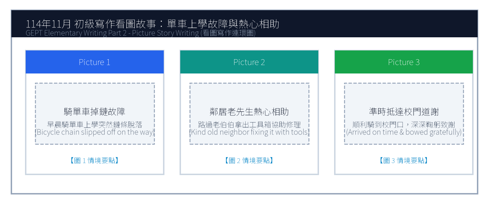
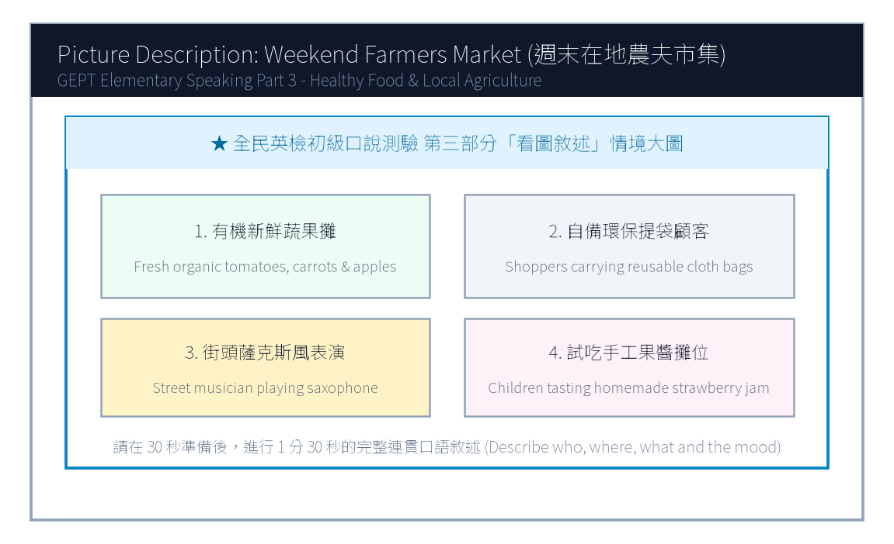

# 114年度第3次 全民英檢初級說寫測驗（第二試常態初試）全真試卷暨名師詳解

> **測驗代碼**：`GEPT-E-114-11-SW`  
> **測驗日期**：`2025 年 11 月 15 日（初級複試常態測驗）`  
> **測驗級數**：`初級（CEFR A2 級）`  
> **測驗項目**：`寫作能力測驗（40 分鐘）＆ 口說能力測驗（約 10 分鐘）`  
> **合格門檻**：`寫作達 70 分以上且口說達 80 分以上（均達 4 級分以上始發證書）`  
> **核心主題**：`鄰里互助美德、騎單車上學故障相助、在地農夫市集、均衡飲食與休閒`  

---

## 📝 第一單元：全真試題本 (Question Booklet)
> **考生注意事項**：本卷分為寫作能力測驗與口說能力測驗。所有題目上方已附專屬圖表，答案與滿分示範講稿已移至**整張試卷最後面**，請先完成作答再行翻閱核對。

### ✍️ 第一部分：寫作能力測驗 (Writing Test - 40分鐘)
#### 第一單元：單句寫作 (Questions 1–15)
1. Henry drinks three cups of black coffee every day. (改為否定句)
作答區：_________________________________________________________________

2. The high-speed rail ticket to Kaohsiung costs fifteen hundred dollars. (依畫線部分 fifteen hundred dollars 造原問句)
作答區：_________________________________________________________________

3. Making new friends at summer camp is exciting. (用 It is... 改寫)
作答區：_________________________________________________________________

4. Thousands of international runners ran the Taipei Marathon yesterday. (改為被動語態)
作答區：_________________________________________________________________

5. The suitcase was so heavy that the little boy could not carry it upstairs. (用 too... to... 改寫)
作答區：_________________________________________________________________

6. on the subway / left / his black umbrella / Uncle Tom / this morning
作答區：_________________________________________________________________

7. healthy habits / essential / to develop / is / for teenagers
作答區：_________________________________________________________________

8. in the kitchen / a delicious chocolate cake / baked / Mom and Kelly
作答區：_________________________________________________________________

9. a street cat / saw / sleeping peacefully / under the bench / we
作答區：_________________________________________________________________

10. start / the basketball match / will / when / ?
作答區：_________________________________________________________________

11. Kevin worked hard in the garden all morning. / He did not feel tired at all. (用 Although 合併)
作答區：_________________________________________________________________

12. You can take the green bus to the museum. / You can walk there in ten minutes. (用 either... or... 合併)
作答區：_________________________________________________________________

13. The girl is my cousin Emily. / She won first prize in the national speech contest. (用 who 合併)
作答區：_________________________________________________________________

14. We went to the organic farmers market. / We wanted to purchase fresh vegetables. (用 to 或 in order to 合併)
作答區：_________________________________________________________________

15. An elephant is heavier than a horse. / A blue whale is heavier than an elephant. (用 heaviest 合併)
作答區：_________________________________________________________________

#### 第二單元：段落寫作 (Question 16 看圖短文寫作)

16. 請依據下列三幅連環圖畫內容，寫一篇約 50 字的短文故事，敘述早晨上學途中腳踏車掉鏈故障，獲得鄰居老爺爺熱心相助並準時抵達學校的經歷。

### 🎙️ 第二部分：口說能力測驗 (Speaking Test - 約10分鐘)
#### 第一單元：朗讀短文 (Questions 1–2)
**Question 1 朗讀短文**：
> Passage 1: Welcome to the Taipei Botanical Garden. We have more than two thousand plant species from tropical and subtropical regions. Please stay on the marked wooden boardwalks and do not pluck flowers or pick fruit. We hope you have an educational and relaxing visit.

**Question 2 朗讀短文**：
> Passage 2: Regular exercise is a wonderful way to boost your immune system and elevate your mood. Whether you prefer swimming, cycling, or playing basketball, dedicating thirty minutes three times a week will make your heart stronger and give you boundless energy.

#### 第二單元：回答問題 (Questions 3–12)
- 3. What time do you usually wake up on weekdays?
- 4. What is your favorite subject at school?
- 5. Do you prefer eating at home or dining out at restaurants?
- 6. What kind of books do you enjoy reading the most?
- 7. Tell me about your favorite holiday of the year.
- 8. How do you keep in touch with your friends during summer vacation?
- 9. What would you do if it rains heavily on your sports day?
- 10. What musical instrument would you like to learn?
- 11. How do you usually help around the house?
- 12. What was the most memorable trip you have ever taken?

#### 第三單元：看圖敘述 (Question 13 情境大圖口語敘述)

13. 請仔細觀察圖片，有 30 秒的準備時間。之後請在 1 分 30 秒內，根據圖中週末在地農夫市集的情境作一完整連貫的口述敘述。

---

## 🎯 試題答案與名師深度解析手冊 (Answer Key & Explanations)
> **本篇置於整張試卷最後面**，供作答完畢後核對成績、滿分範文觀摩與考點診斷使用。

### 一、寫作能力測驗 標準答案與滿分解析
#### 【第一部分：單句寫作 1–15 題標準答案】
- **第 1 題**：`Henry does not drink three cups of black coffee every day.`
- **第 2 題**：`How much does the high-speed rail ticket to Kaohsiung cost?`
- **第 3 題**：`It is exciting to make new friends at summer camp.`
- **第 4 題**：`The Taipei Marathon was run by thousands of international runners yesterday.`
- **第 5 題**：`The suitcase was too heavy for the little boy to carry upstairs.`
- **第 6 題**：`Uncle Tom left his black umbrella on the subway this morning.`
- **第 7 題**：`It is essential for teenagers to develop healthy habits.`
- **第 8 題**：`Mom and Kelly baked a delicious chocolate cake in the kitchen.`
- **第 9 題**：`We saw a street cat sleeping peacefully under the bench.`
- **第 10 題**：`When will the basketball match start?`
- **第 11 題**：`Although Kevin worked hard in the garden all morning, he did not feel tired at all.`
- **第 12 題**：`You can either take the green bus to the museum or walk there in ten minutes.`
- **第 13 題**：`The girl who won first prize in the national speech contest is my cousin Emily.`
- **第 14 題**：`We went to the organic farmers market to purchase fresh vegetables.`
- **第 15 題**：`A blue whale is the heaviest of the three.`

#### 【第二部分：段落看圖寫作 5 級分滿分範文】
> **滿分範文**：
> "Yesterday morning, Andy was hurriedly riding his bicycle to school when the chain suddenly slipped off, bringing his bike to a complete halt. Just as he felt anxious about being late, a kind elderly neighbor named Mr. Chen noticed his trouble and immediately brought out a heavy metal toolbox. With skilled hands, Mr. Chen helped Andy fix and grease the chain within five minutes. Andy arrived at the school gate just before the bell rang, bowing deeply to thank the warm-hearted gentleman."

### 二、口說能力測驗 滿分示範講稿與逐字稿
#### 【第二單元：回答問題 10 題 滿分示範答句】
- **3. What time do you usually wake up on weekdays?**
  - *滿分示範*："I usually wake up at six-thirty on weekday mornings so I have plenty of time to eat a nutritious breakfast and walk to the bus stop."
- **4. What is your favorite subject at school?**
  - *滿分示範*："My favorite subject is science because we conduct fascinating experiments in the laboratory, such as testing chemical reactions and observing plant cells."
- **5. Do you prefer eating at home or dining out at restaurants?**
  - *滿分示範*："I prefer eating at home because my parents' home-cooked meals are much healthier, less oily, and we can chat leisurely at the dinner table."
- **6. What kind of books do you enjoy reading the most?**
  - *滿分示範*："I enjoy reading science-fiction adventure novels because they ignite my imagination about space travel, robots, and futuristic cities."
- **7. Tell me about your favorite holiday of the year.**
  - *滿分示範*："My favorite holiday is Lunar New Year because the whole family gathers for a festive reunion dinner, and my grandparents give us lucky red envelopes."
- **8. How do you keep in touch with your friends during summer vacation?**
  - *滿分示範*："I usually chat with my friends through instant messaging apps and we often meet up at the community sports center to play basketball."
- **9. What would you do if it rains heavily on your sports day?**
  - *滿分示範*："If it rains on sports day, our school will move the relay races and opening ceremony into the indoor gymnasium so we can still have fun."
- **10. What musical instrument would you like to learn?**
  - *滿分示範*："I would like to learn to play the acoustic guitar because it is portable and I can play and sing cheerful songs around campfires with friends."
- **11. How do you usually help around the house?**
  - *滿分示範*："I help sweep and mop the kitchen floor every weekend, and I water our balcony potted flowers every morning before leaving for school."
- **12. What was the most memorable trip you have ever taken?**
  - *滿分示範*："The most memorable trip was visiting Sun Moon Lake with my parents last autumn. We rode bicycles along the lake trail and the misty scenery was breathtaking."

#### 【第三單元：看圖敘述 90 秒完整連貫滿分講稿】
> **滿分講稿**：
> "This delightful picture portrays a bustling weekend farmers market held in the town square under the clear blue sky. On the left, several friendly local farmers are displaying neatly arranged wooden crates filled with freshly picked organic tomatoes, crunchy carrots, and red apples. In the center, smiling customers carrying reusable canvas bags are happily chatting with vendors and sampling homemade strawberry jam. Towards the right side, a street musician wearing a stylish hat is playing soothing saxophone melodies, creating a cheerful and relaxed weekend atmosphere. Nearby, young children are laughing as they watch a balloon artist twist colorful animal balloons. The entire square is vibrant, healthy, and filled with community warmth."

### 三、本卷核心考點單字與高頻實用片語表
| 考點單字／片語 | 詞性 | 中文核心語意 | 生活情境搭配例句 |
| :---: | :---: | :---: | :---: |
| **slipped off** | phr. | 脫落、滑落 | The bike chain slipped off while riding uphill. |
| **warm-hearted** | adj. | 熱心的、好心腸的 | Our warm-hearted neighbors always help each other. |
| **botanical garden** | n. | 植物園 | admire exotic orchids at the Taipei Botanical Garden |
| **immune system** | n. | 免疫系統 | Eating fresh citrus fruits strengthens your immune system. |
| **organic** | adj. | 有機的 | purchase fresh organic vegetables directly from local growers |
| **boardwalk** | n. | 木棧道 | Visitors are required to stay on the designated boardwalk. |
| **nutritious** | adj. | 有營養的 | A boiled egg and milk make a nutritious breakfast. |
| **crate** | n. | 木箱、塑膠簍 | stacked wooden crates of fresh seasonal strawberries |
| **canvas bag** | n. | 帆布袋 | bring reusable canvas bags to reduce plastic waste |
| **breathtaking** | adj. | 令人屏息的、極為壯麗的 | The sunrise over the mountains was truly breathtaking. |
