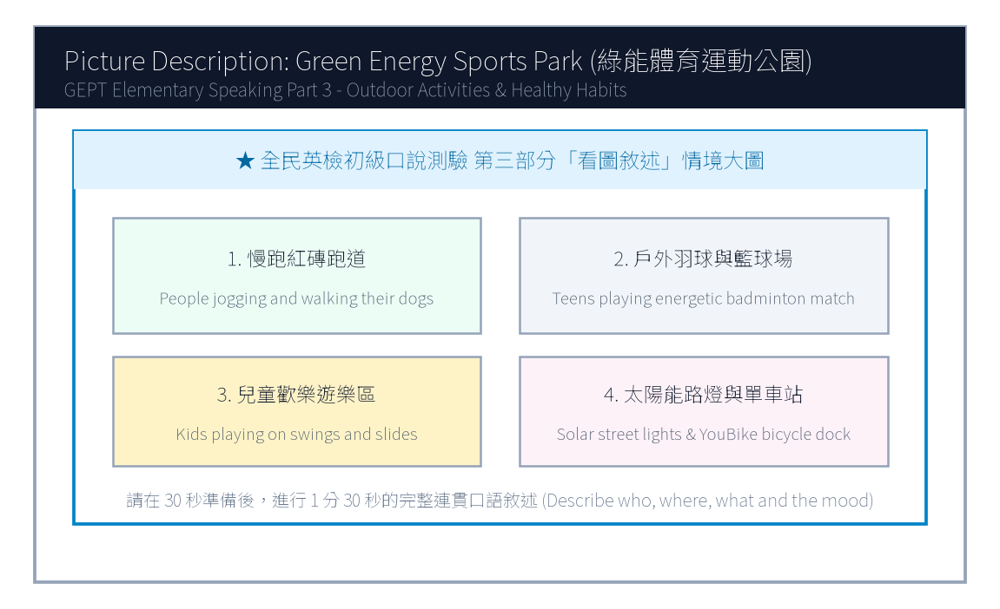

# 115年度第1次 全民英檢初級說寫測驗（第二試／一日考）模擬試題（依官方題型編製）暨詳解

> **測驗代碼**：`GEPT-E-115-01-SW`  
> **測驗日期**：`2026 年 01 月 10 日（一日考說寫複試）`  
> **測驗級數**：`初級（CEFR A2 級）`  
> **測驗項目**：`寫作能力測驗（40 分鐘）＆ 口說能力測驗（約 10 分鐘）`  
> **合格門檻**：`寫作達 70 分以上且口說達 80 分以上（均達 4 級分以上始發證書）`  
> **核心主題**：`家庭溫馨親情、秘密烤蛋糕驚喜慶生、綠能體育運動公園、活力休閒生活`  

---

## 📝 第一單元：模擬試題本 (Question Booklet)
> **考生注意事項**：本卷分為寫作能力測驗與口說能力測驗。所有題目上方已附專屬圖表，答案與滿分示範講稿已移至**整張試卷最後面**，請先完成作答再行翻閱核對。

### ✍️ 第一部分：寫作能力測驗 (Writing Test - 40分鐘)
#### 第一單元：單句寫作 (Questions 1–15)
1. George goes jogging in the community sports park every morning. (改為否定句)
作答區：_________________________________________________________________

2. The high school soccer team won five championship matches last year. (依畫線部分 five 造原問句)
作答區：_________________________________________________________________

3. To speak English with native speakers requires lots of courage. (用 It takes... 或 It requires... 改寫)
作答區：_________________________________________________________________

4. Many curious students visited the newly opened science museum yesterday. (改為被動語態)
作答區：_________________________________________________________________

5. The box of antique porcelain was so fragile that nobody dared to move it. (用 too... to... 改寫)
作答區：_________________________________________________________________

6. on the blackboard / wrote / an important message / the English teacher
作答區：_________________________________________________________________

7. good posture / essential / to maintain / for teenagers / is
作答區：_________________________________________________________________

8. a birthday gift / bought / for her younger sister / yesterday / Alice
作答區：_________________________________________________________________

9. the baby birds / in their nest / chirping hungrily / we heard
作答區：_________________________________________________________________

10. leave / the next express train / will / when / ?
作答區：_________________________________________________________________

11. Leo prepared thoroughly for the swimming contest. / He did not win any medals. (用 Although 合併)
作答區：_________________________________________________________________

12. You may drink freshly squeezed orange juice. / You may have a cup of hot chocolate. (用 either... or... 合併)
作答區：_________________________________________________________________

13. The lady is our school principal. / She delivered an inspiring speech this morning. (用 who 合併)
作答區：_________________________________________________________________

14. They traveled to Hualien. / They wanted to admire the magnificent Taroko Gorge. (用 to 或 in order to 合併)
作答區：_________________________________________________________________

15. A motorcycle is heavier than a bicycle. / A truck is heavier than a motorcycle. (用 heaviest 合併)
作答區：_________________________________________________________________

#### 第二單元：段落寫作 (Question 16 看圖短文寫作)

16. 請依據下列三幅連環圖畫內容，寫一篇約 50 字的短文故事，敘述姊弟倆在廚房秘密為媽媽烘焙生日蛋糕，雖然蛋糕烤焦了一角但媽媽依然感動無比的溫馨經過。

### 🎙️ 第二部分：口說能力測驗 (Speaking Test - 約10分鐘)
#### 第一單元：朗讀短文 (Questions 1–2)
**Question 1 朗讀短文**：
> Passage 1: Good afternoon, passengers. We are now approaching Taichung High Speed Rail Station. Please gather all your personal belongings and check the overhead luggage racks. Do not leave your mobile phones or transit cards on the seats. Thank you for riding with Taiwan High Speed Rail.

**Question 2 朗讀短文**：
> Passage 2: Trees are the lungs of our planet. They absorb harmful carbon dioxide from the air and release pure oxygen for humans and animals to breathe. In addition, deep tree roots anchor the soil and prevent destructive landslides during heavy summer typhoons. Planting trees creates a greener world.

#### 第二單元：回答問題 (Questions 3–12)
- 3. What is your favorite kind of fruit?
- 4. How do you usually spend your time after finishing homework?
- 5. What kind of pets do you like the most?
- 6. Do you enjoy cooking or helping out in the kitchen?
- 7. Tell me about an interesting place you visited recently.
- 8. How do you celebrate New Year's Eve with your family?
- 9. What subject do you find the most challenging, and why?
- 10. What do you do when you catch a cold?
- 11. Do you prefer watching sports on TV or playing them yourself?
- 12. If you could have any superpower, what would it be?

#### 第三單元：看圖敘述 (Question 13 情境大圖口語敘述)

13. 請仔細觀察圖片，有 30 秒的準備時間。之後請在 1 分 30 秒內，根據圖中綠能體育運動公園的情境作一完整連貫的口述敘述。

---

## 🎯 試題答案與名師深度解析手冊 (Answer Key & Explanations)
> **本篇置於整張試卷最後面**，供作答完畢後核對成績、滿分範文觀摩與考點診斷使用。

### 一、寫作能力測驗 標準答案與滿分解析
#### 【第一部分：單句寫作 1–15 題標準答案】
- **第 1 題**：`George does not go jogging in the community sports park every morning.`
- **第 2 題**：`How many championship matches did the high school soccer team win last year?`
- **第 3 題**：`It takes lots of courage to speak English with native speakers.`
- **第 4 題**：`The newly opened science museum was visited by many curious students yesterday.`
- **第 5 題**：`The box of antique porcelain was too fragile for anybody to move.`
- **第 6 題**：`The English teacher wrote an important message on the blackboard.`
- **第 7 題**：`It is essential for teenagers to maintain good posture.`
- **第 8 題**：`Alice bought a birthday gift for her younger sister yesterday.`
- **第 9 題**：`We heard the baby birds chirping hungrily in their nest.`
- **第 10 題**：`When will the next express train leave?`
- **第 11 題**：`Although Leo prepared thoroughly for the swimming contest, he did not win any medals.`
- **第 12 題**：`You may either drink freshly squeezed orange juice or have a cup of hot chocolate.`
- **第 13 題**：`The lady who delivered an inspiring speech this morning is our school principal.`
- **第 14 題**：`They traveled to Hualien in order to admire the magnificent Taroko Gorge.`
- **第 15 題**：`A truck is the heaviest of the three.`

#### 【第二部分：段落看圖寫作 5 級分滿分範文】
> **滿分範文**：
> "Yesterday was Mom's birthday, so Cindy and her younger brother decided to bake a surprise strawberry cake before she returned from work. However, because they accidentally set the oven temperature too high, dark smoke poured out and the cake was slightly charred on top. Just as they felt discouraged and messy with flour all over their faces, Mom walked in and understood everything immediately. She embraced them with tears of joy, happily tasting the burnt cake and declaring it the sweetest gift ever."

### 二、口說能力測驗 滿分示範講稿與逐字稿
#### 【第二單元：回答問題 10 題 滿分示範答句】
- **3. What is your favorite kind of fruit?**
  - *滿分示範*："My favorite fruit is watermelon because it is extremely juicy, sweet, and refreshing, especially on scorching hot summer days."
- **4. How do you usually spend your time after finishing homework?**
  - *滿分示範*："After finishing my homework, I usually practice playing the acoustic guitar for thirty minutes or walk our dog in the neighborhood park."
- **5. What kind of pets do you like the most?**
  - *滿分示範*："I like golden retrievers the most because they are exceptionally loyal, gentle with children, and always wag their tails joyfully."
- **6. Do you enjoy cooking or helping out in the kitchen?**
  - *滿分示範*："Yes, I really enjoy helping my mother prepare dinner, especially washing fresh vegetables and beating eggs for fried rice."
- **7. Tell me about an interesting place you visited recently.**
  - *滿分示範*："Recently, I visited the Taipei Astronomical Museum. The giant 3D planetarium show made me feel like I was floating among distant galaxies."
- **8. How do you celebrate New Year's Eve with your family?**
  - *滿分示範*："On New Year's Eve, my family eats hot pot dinner together, watches the festive concert on television, and countdowns to the spectacular 101 fireworks display."
- **9. What subject do you find the most challenging, and why?**
  - *滿分示範*："I find history the most challenging because there are so many dynasties, historical figures, and treaty dates that require careful memorization."
- **10. What do you do when you catch a cold?**
  - *滿分示範*："When I catch a cold, I visit a clinic immediately, drink plenty of warm lemon water, and sleep early so my body can recover quickly."
- **11. Do you prefer watching sports on TV or playing them yourself?**
  - *滿分示範*："I prefer playing sports myself because running on the court and sweating with my classmates is much more thrilling and healthy than watching passively."
- **12. If you could have any superpower, what would it be?**
  - *滿分示範*："If I could have a superpower, I would love the ability to fly so I could soar above the clouds and explore every continent without traffic jams."

#### 【第三單元：看圖敘述 90 秒完整連貫滿分講稿】
> **滿分講稿**：
> "This energetic picture shows a sunny Sunday afternoon at the newly opened city sports park. In the center foreground, several enthusiastic teenagers are playing a fast-paced badminton doubles match, leaping into the air to smash the shuttlecock. Encircling the sports fields is a wide brick-red track where joggers of various ages are running steadily to the rhythm of upbeat music. Over to the right, a joyful playground is filled with small children sliding down bright yellow slides and giggling on swings under their parents' watchful eyes. In the background, modern solar-powered streetlights line the pathways, and a shared bicycle docking station offers green commuting options. The park is vibrant, clean, and full of healthy outdoor vitality."

### 三、本卷核心考點單字與高頻實用片語表
| 考點單字／片語 | 詞性 | 中文核心語意 | 生活情境搭配例句 |
| :---: | :---: | :---: | :---: |
| **charred** | adj. | 燒焦的 | The cake was slightly charred on top, but the inside was soft. |
| **discouraged** | adj. | 氣餒的、沮喪的 | Don't feel discouraged when facing difficult challenges. |
| **overhead rack** | n. | 頭頂行李架 | Place your heavy backpacks on the overhead luggage rack. |
| **carbon dioxide** | n. | 二氧化碳 | Green plants absorb carbon dioxide during photosynthesis. |
| **landslide** | n. | 土石流、山崩 | Heavy rainfall during typhoons may trigger dangerous landslides. |
| **scorching** | adj. | 炙熱的、滾燙的 | drink lots of water on scorching summer afternoons |
| **planetarium** | n. | 天文館、天象儀 | watch an immersive 3D show at the science planetarium |
| **vitality** | n. | 活力、生機 | The young athletes showed incredible energy and vitality. |
| **shuttlecock** | n. | 羽毛球 | hit the shuttlecock over the badminton net with precision |
| **commute** | v./n. | 通勤 | Many students commute to school by taking public buses. |
