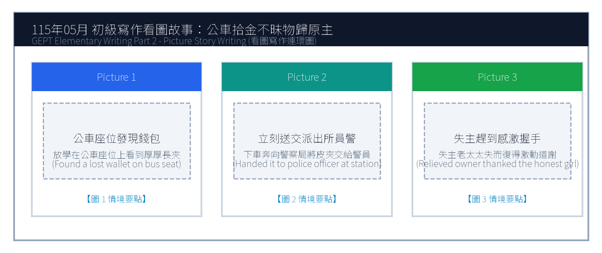
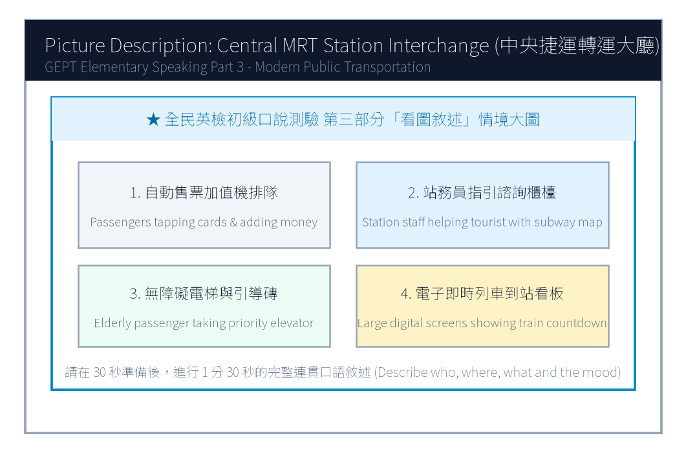

# 115年度第2次 全民英檢初級說寫測驗（第二試常態初試）全真試卷暨名師詳解

> **測驗代碼**：`GEPT-E-115-05-SW`  
> **測驗日期**：`2026 年 05 月 16 日（初級複試常態測驗）`  
> **測驗級數**：`初級（CEFR A2 級）`  
> **測驗項目**：`寫作能力測驗（40 分鐘）＆ 口說能力測驗（約 10 分鐘）`  
> **合格門檻**：`寫作達 70 分以上且口說達 80 分以上（均達 4 級分以上始發證書）`  
> **核心主題**：`拾金不昧公民道德、公車掉皮夾物歸原主、中央捷運轉運通勤、公眾交通安全`  

---

## 📝 第一單元：全真試題本 (Question Booklet)
> **考生注意事項**：本卷分為寫作能力測驗與口說能力測驗。所有題目上方已附專屬圖表，答案與滿分示範講稿已移至**整張試卷最後面**，請先完成作答再行翻閱核對。

### ✍️ 第一部分：寫作能力測驗 (Writing Test - 40分鐘)
#### 第一單元：單句寫作 (Questions 1–15)
1. Many passengers take the rapid transit system during rush hour. (改為否定句)
作答區：_________________________________________________________________

2. The high school volleyball team practices three times a week. (依畫線部分 three times a week 造原問句)
作答區：_________________________________________________________________

3. Wearing a safety helmet when riding a scooter is required by law. (用 It is... 改寫)
作答區：_________________________________________________________________

4. An honest schoolboy handed the lost smartphone to the police officer. (改為被動語態)
作答區：_________________________________________________________________

5. The English reading passage was so complicated that none of us could comprehend it. (用 too... to... 改寫)
作答區：_________________________________________________________________

6. on the library shelf / returned / the science magazines / the student
作答區：_________________________________________________________________

7. traffic regulations / vital / to obey / for pedestrians / is
作答區：_________________________________________________________________

8. a brand new backpack / bought / for the new semester / Kevin
作答區：_________________________________________________________________

9. in the distance / heard / thunder rumbling / we / this afternoon
作答區：_________________________________________________________________

10. the next bus / arrive / at the bus stop / will / when / ?
作答區：_________________________________________________________________

11. Grace was feeling nervous before the English speech. / She spoke fluently on stage. (用 Although 合併)
作答區：_________________________________________________________________

12. You can take the circular bus to the hospital. / You can take the metro train. (用 either... or... 合併)
作答區：_________________________________________________________________

13. The police officer was praised by the mayor. / He helped an elderly woman find her lost grandson. (用 who 合併)
作答區：_________________________________________________________________

14. Mr. Wang exercised daily. / He wanted to lower his blood pressure and stay healthy. (用 to 或 in order to 合併)
作答區：_________________________________________________________________

15. A bicycle is slower than a scooter. / A pedestrian is slower than a bicycle. (用 slowest 合併)
作答區：_________________________________________________________________

#### 第二單元：段落寫作 (Question 16 看圖短文寫作)

16. 請依據下列三幅連環圖畫內容，寫一篇約 50 字的短文故事，敘述女孩在公車座位上發現一個掉落的長夾，下車後立刻送至派出所交給員警，失主老太太失而復得激動感謝的拾金不昧經過。

### 🎙️ 第二部分：口說能力測驗 (Speaking Test - 約10分鐘)
#### 第一單元：朗讀短文 (Questions 1–2)
**Question 1 朗讀短文**：
> Passage 1: Attention all passengers. The airport express train bound for Taoyuan International Airport is now boarding at platform two. Please stand behind the yellow safety line until the train comes to a complete stop. Mind the platform gap when boarding and keep your luggage secure.

**Question 2 朗讀短文**：
> Passage 2: The habit of reading broadens our horizons and enhances our understanding of the diverse world. When we read biographical memoirs or historical fiction, we experience extraordinary adventures and develop empathy for people from different cultural backgrounds. Reading is a lifelong treasure.

#### 第二單元：回答問題 (Questions 3–12)
- 3. What time do you usually eat dinner on weekdays?
- 4. Where do you like to buy your school supplies?
- 5. What is your favorite outdoor sport, and how often do you play it?
- 6. Do you enjoy taking public transportation such as buses and trains?
- 7. Tell me about your favorite family holiday tradition.
- 8. What would you do if someone dropped their wallet in front of you?
- 9. How do you prepare for an important English examination?
- 10. What kind of music helps you relax after a tiring day?
- 11. Do you prefer living in a bustling city or a quiet countryside?
- 12. What is a goal you hope to achieve this year?

#### 第三單元：看圖敘述 (Question 13 情境大圖口語敘述)

13. 請仔細觀察圖片，有 30 秒的準備時間。之後請在 1 分 30 秒內，根據圖中繁忙的中央捷運轉運大廳情境作一完整連貫的口述敘述。

---

## 🎯 試題答案與名師深度解析手冊 (Answer Key & Explanations)
> **本篇置於整張試卷最後面**，供作答完畢後核對成績、滿分範文觀摩與考點診斷使用。

### 一、寫作能力測驗 標準答案與滿分解析
#### 【第一部分：單句寫作 1–15 題標準答案】
- **第 1 題**：`Many passengers do not take the rapid transit system during rush hour.`
- **第 2 題**：`How often does the high school volleyball team practice?`
- **第 3 題**：`It is required by law to wear a safety helmet when riding a scooter.`
- **第 4 題**：`The lost smartphone was handed to the police officer by an honest schoolboy.`
- **第 5 題**：`The English reading passage was too complicated for any of us to comprehend.`
- **第 6 題**：`The student returned the science magazines on the library shelf.`
- **第 7 題**：`It is vital for pedestrians to obey traffic regulations.`
- **第 8 題**：`Kevin bought a brand new backpack for the new semester.`
- **第 9 題**：`We heard thunder rumbling in the distance this afternoon.`
- **第 10 題**：`When will the next bus arrive at the bus stop?`
- **第 11 題**：`Although Grace was feeling nervous before the English speech, she spoke fluently on stage.`
- **第 12 題**：`You can either take the circular bus to the hospital or take the metro train.`
- **第 13 題**：`The police officer who helped an elderly woman find her lost grandson was praised by the mayor.`
- **第 14 題**：`Mr. Wang exercised daily in order to lower his blood pressure and stay healthy.`
- **第 15 題**：`A pedestrian is the slowest of the three.`

#### 【第二部分：段落看圖寫作 5 級分滿分範文】
> **滿分範文**：
> "While riding the public bus home yesterday, Brenda spotted a thick leather wallet forgotten on an empty seat. Knowing the owner must be frantic, she resisted any selfish temptation, immediately got off at the next stop, and carried the wallet directly to the nearby police station. Within an hour, a tearful elderly woman arrived and was immensely relieved to recover her identification documents and pension money. The grateful grandmother thanked Brenda with warm hugs, praising her as a shining example of honesty."

### 二、口說能力測驗 滿分示範講稿與逐字稿
#### 【第二單元：回答問題 10 題 滿分示範答句】
- **3. What time do you usually eat dinner on weekdays?**
  - *滿分示範*："I usually eat dinner at seven o'clock with my parents after everyone finishes work and classes. We enjoy delicious hot soup and share stories about our day."
- **4. Where do you like to buy your school supplies?**
  - *滿分示範*："I like buying my stationery at a large bookstore near our school because they have an enormous variety of colorful gel pens, notebooks, and stickers."
- **5. What is your favorite outdoor sport, and how often do you play it?**
  - *滿分示範*："My favorite outdoor sport is basketball. I play full-court games with my classmates twice a week at the school playground."
- **6. Do you enjoy taking public transportation such as buses and trains?**
  - *滿分示範*："Yes, I really enjoy taking the MRT because the train cabins are immaculately clean, comfortable, and never get stuck in frustrating traffic jams."
- **7. Tell me about your favorite family holiday tradition.**
  - *滿分示範*："Every Mid-Autumn Festival, our family gathers on our apartment rooftop to barbecue seafood, peel sweet pomelos, and admire the bright harvest moon."
- **8. What would you do if someone dropped their wallet in front of you?**
  - *滿分示範*："I would instantly call out to the person and return the wallet to them. If they walked away too fast, I would hand it to the nearest police officer."
- **9. How do you prepare for an important English examination?**
  - *滿分示範*："I review vocabulary flashcards daily, listen to English radio podcasts during my commute, and practice writing short essays to reinforce grammar."
- **10. What kind of music helps you relax after a tiring day?**
  - *滿分示範*："Soft acoustic guitar music and gentle piano melodies help me relax the most, as they soothe my tired nerves and help me fall asleep peacefully."
- **11. Do you prefer living in a bustling city or a quiet countryside?**
  - *滿分示範*："I prefer living in a bustling city because everything is convenient; libraries, convenience stores, and train stations are all within walking distance."
- **12. What is a goal you hope to achieve this year?**
  - *滿分示範*："My main goal this year is to pass the GEPT Elementary test with high scores and improve my spoken English so I can communicate confidently with foreign tourists."

#### 【第三單元：看圖敘述 90 秒完整連貫滿分講稿】
> **滿分講稿**：
> "This bustling illustration depicts the main concourse of a central metro interchange station during the busy afternoon commute. In the center, travelers carrying rolling suitcases are standing in orderly lines before automatic ticket machines, topping up transit cards or buying tokens. Over to the left near the information counter, a polite station worker in uniform is pointing at an electronic subway map to guide a lost foreign traveler. In the background on the right, passengers are stepping onto modern escalators, while an elderly person in a wheelchair is using the priority elevator with ease. Huge electronic screens hanging overhead clearly display upcoming train arrivals and transfer gates. The station is exceptionally bright, spotless, and running with impressive efficiency."

### 三、本卷核心考點單字與高頻實用片語表
| 考點單字／片語 | 詞性 | 中文核心語意 | 生活情境搭配例句 |
| :---: | :---: | :---: | :---: |
| **frantic** | adj. | 極度焦急的、心急如焚的 | The mother was frantic when her toddler wandered away. |
| **pension** | n. | 退休金、養老金 | Many retirees rely on their monthly government pension. |
| **concourse** | n. | 中央大廳、轉運大廳 | The grand concourse of the station was filled with commuters. |
| **pedestrian** | n. | 行人 | Drivers must yield the right of way to pedestrians at crosswalks. |
| **empathy** | adj. | 同理心 | Reading stories about diverse cultures fosters deep empathy. |
| **spotless** | adj. | 一塵不染的、極為乾淨的 | The hotel lobby and metro station were completely spotless. |
| **stationery** | n. | 文具 | buy colorful highlighters and notebooks at the stationery store |
| **pomelo** | n. | 柚子、文旦 | eating sweet pomelos during the Mid-Autumn Festival |
| **soothe** | v. | 撫慰、使平靜 | Soft ambient music helped soothe the stressed patient. |
| **efficiency** | n. | 效率 | Taiwan's high-speed rail operates with remarkable efficiency. |
